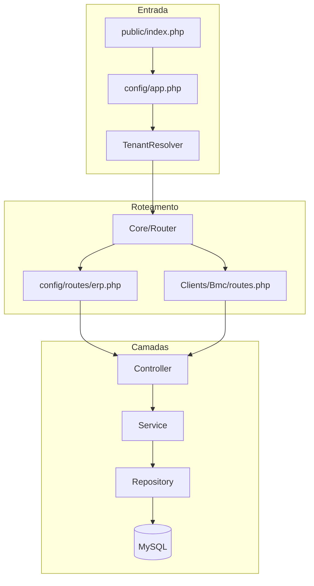
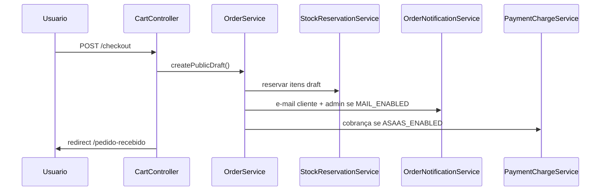

# PROJECT MASTER — Brief Consolidado do Produto ERP

> **Documento único para planejamento externo (IA, stakeholders, onboarding técnico).**  
> **Gerado em:** 2026-06-08  
> **Estado refletido:** Fase C concluída (Sprints 1–7); pronto para smoke test pré-go-live BMC.

---

## 0. Instruções para IA / leitor externo

### O que é este produto

Monólito modular PHP 8.1+ (**ERP + e-commerce**) com:

- **Backoffice ERP** reutilizável (`app/Erp/`)
- **Sites públicos por cliente** (`app/Clients/{Bmc,Demo}/`)
- **Framework próprio** em `core/` (sem Laravel/Symfony)
- **MySQL** via PDO singleton
- **Deploy típico:** XAMPP / Apache / MySQL

### O que NÃO é (ainda)

| Expectativa SaaS | Realidade AS-IS |
|------------------|-----------------|
| Isolamento de dados por tenant no banco | **Não** — ERP e pedidos compartilham o mesmo MySQL |
| Admin escopado por tenant | **Não** — `/admin` é único para todos |
| Onboarding self-service de novo tenant | **Não** — clientes registrados manualmente em código |
| Billing/assinatura por tenant | **Não** |
| Gateway/config financeira por tenant | **Não** — Asaas global via `.env` |
| Cartão / boleto | **Não** — apenas Pix (Asaas) |
| Funil comercial (catálogo → pedido) | **Não** — Sprint 8 pendente |

O produto é **multi-cliente reutilizável** (branding, rotas, assets por tenant), não uma plataforma SaaS completa.

### Regras arquiteturais invioláveis

1. **Core neutro** — `core/` não contém regra de negócio, marca ou config de cliente.
2. **ERP genérico** — `app/Erp/` proibido de referenciar BMC, Barros ou qualquer marca de tenant.
3. **Pipeline HTTP:** `Controller → Service → Repository → PDO`. Controllers só orquestram; SQL só em Repositories.
4. **Views sem SQL** — renderização via `Shared\View\ViewRenderer` com prefixos `erp::`, `client::`, `shared::`.
5. **Monólito único** — front controller em `public/index.php`; sem microsserviços.
6. **Namespaces oficiais:** `Core\`, `Erp\`, `Clients\`, `Shared\`, `Database\`. Namespace legado `App\` removido.
7. **BMC Barros** é **Cliente 1** (`Clients/Bmc`), não identidade do produto.

### Fontes oficiais vs este documento

| Documento | Papel |
|-----------|-------|
| [`PROJECT_CONTEXT.md`](PROJECT_CONTEXT.md) | AS-IS oficial, módulos, próximos passos |
| [`ARCHITECTURE.md`](../ARCHITECTURE.md) | Mapa técnico oficial |
| [`PHASE_C_BACKLOG.md`](PHASE_C_BACKLOG.md) | Registro detalhado das Sprints 1–7 |
| **Este arquivo** | Brief consolidado para outra IA montar planos sem ler 15+ arquivos |

---

## 1. Resumo executivo

**Produto:** ERP comercial reutilizável + loja online transacional, preparado para múltiplos clientes via configuração (não duplicação de código).

**Cliente 1:** BMC Barros — implementação em `app/Clients/Bmc/` (site institucional + catálogo + checkout).

**Cliente demonstrativo:** `app/Clients/Demo/` — prova de troca de tenant.

**Status (2026-06-08):**

- Fase C (Sprints 1–7) **implementada**: e-mail, reserva de estoque, conta do cliente, financeiro, Pix Asaas, multi-tenant por domínio, logística.
- Projeto **pronto para smoke test pré-go-live** do cliente BMC.
- **Próximo passo imediato:** validação (4 cenários de pagamento) → go-live → evoluções pós-MVP.

**Decisão do coordenador (2026-06-07):** finalizar → testar → go-live → evoluir depois. Estorno/vencimento adiados de propósito.

---

## 2. Stack e como rodar

### Stack

| Camada | Tecnologia |
|--------|------------|
| Linguagem | PHP 8.1+ |
| Banco | MySQL |
| Servidor | Apache (XAMPP) |
| Dependências | Composer (PSR-4, Dotenv, PHPMailer) |
| Testes | PHPUnit 10 |
| Framework HTTP | Próprio em `core/` |

### Setup local (resumo)

```bash
composer install
copy .env.example .env          # Windows
# Ajustar BASE_URL, DB_*, ACTIVE_CLIENT

# Banco: importar database/schema/erp_product_full.sql
# OU: php migrate.php run

php database/seeds/criar_admin.php "admin@exemplo.com" "SenhaForte123"

# Acessar BASE_URL (ex.: http://localhost/bmc_barros/public)
# Admin: /admin/login
```

### Testes

```bash
composer dump-autoload
vendor/bin/phpunit -c phpunit.xml.dist
# Integração MySQL opcional: ERP_RUN_INTEGRATION=1 vendor/bin/phpunit
```

### Variáveis `.env` agrupadas

**Aplicação**

| Variável | Descrição |
|----------|-----------|
| `APP_ENV` | `local` / `production` |
| `APP_DEBUG` | `true` em dev; `false` em produção |
| `BASE_URL` | URL base com `/public` se aplicável |
| `ACTIVE_CLIENT` | `bmc` ou `demo` |
| `TENANT_RESOLUTION` | `env` (fixo) ou `domain` (por HTTP Host) |
| `SESSION_TIMEOUT` | Timeout sessão admin (segundos) |
| `CSRF_TOKEN_LENGTH` | Tamanho token CSRF |

**Banco**

| Variável | Descrição |
|----------|-----------|
| `DB_HOST`, `DB_NAME`, `DB_USER`, `DB_PASS` | Conexão MySQL |

**Features**

| Variável | Descrição |
|----------|-----------|
| `ENABLE_AUDIT` | Auditoria admin |
| `ENABLE_ROLE_BASED_ACCESS` | ACL por role |

**E-mail (Sprint 1)**

| Variável | Descrição |
|----------|-----------|
| `MAIL_ENABLED` | Liga/desliga envio |
| `MAIL_HOST`, `MAIL_PORT`, `MAIL_USERNAME`, `MAIL_PASSWORD` | SMTP |
| `MAIL_FROM`, `MAIL_FROM_NAME`, `MAIL_ENCRYPTION` | Remetente |
| `MAIL_ADMIN_TO` | Alerta admin em pedido online |

**Asaas Pix (Sprint 6)**

| Variável | Descrição |
|----------|-----------|
| `ASAAS_ENABLED` | Liga cobrança Pix no checkout |
| `ASAAS_SANDBOX` | `true` = api-sandbox.asaas.com |
| `ASAAS_API_KEY` | Chave API |
| `ASAAS_WEBHOOK_TOKEN` | Valida header `asaas-access-token` |
| `ASAAS_PIX_DUE_DAYS` | Vencimento da cobrança (1–30) |
| `ASAAS_USER_AGENT` | User-Agent HTTP |

---

## 3. Arquitetura e separação de contextos

### Pipeline HTTP

```text
HTTP Request
  → public/index.php
  → config/app.php
       → Composer autoload
       → .env (Dotenv)
       → constantes globais
       → sessão + SessionGuard
       → TenantResolver (ACTIVE_CLIENT, BASE_URL)
  → Core\App::run()
       → Core\Request::capture()
       → Core\Router::resolve(method, uri)
       → MiddlewarePipeline
            web:     (vazio — rotas públicas)
            admin:   AuthMiddleware → AclMiddleware
            customer: CustomerAuthMiddleware
       → Controller (Erp\Admin ou Clients\{Client}\Site)
       → Service
       → Repository
       → MySQL (PDO)
       → Shared\View\ViewRenderer
       → Core\Response::send()
```



### Contextos oficiais

| Contexto | Namespace | Pasta | Responsabilidade |
|----------|-----------|-------|------------------|
| Core | `Core\` | `core/` | HTTP, router, middleware, database, response |
| ERP | `Erp\` | `app/Erp/` | Produto reutilizável: admin, regras comerciais, persistência |
| Clients | `Clients\` | `app/Clients/` | Sites, branding, rotas públicas, ClientConfig |
| Shared | `Shared\` | `app/Shared/` | TenantResolver, Client, ViewRenderer, helpers |
| Database | `Database\` | `database/` | Migrations e seeds |

### Roteamento modular

| Arquivo | Conteúdo |
|---------|----------|
| `config/routes.php` | Agregador |
| `config/routes/erp.php` | Rotas admin + webhook Asaas |
| `config/routes/clients.php` | Carrega rotas do cliente ativo |
| `app/Clients/Bmc/routes.php` | Rotas públicas BMC |
| `app/Clients/Demo/routes.php` | Rotas públicas Demo |

### Renderização de views

| Prefixo | Raiz |
|---------|------|
| `erp::` | `app/Erp/Admin/Views/` |
| `client::` | `app/Clients/{ActiveClient}/Site/Views/` |
| `shared::` | `app/Shared/View/` |

Exemplo:

```php
$this->view('erp::products/index', $data, 'erp::layouts/admin');
$this->view('client::home', $data);
```

### Assets e uploads

| Tipo | Caminho |
|------|---------|
| Admin CSS/JS | `public/assets/erp/admin/` |
| Site BMC | `public/assets/clients/bmc/site/` |
| Site Demo | `public/assets/clients/demo/site/` |
| Uploads produtos | `public/uploads/clients/{client}/products/` |

Admin e site **não compartilham** layout, CSS ou JS.

---

## 4. Estrutura de diretórios (atualizada)

```text
bmc_barros/
├── app/
│   ├── Erp/
│   │   ├── Admin/          # Controllers + Views admin
│   │   ├── Audit/
│   │   ├── Auth/
│   │   ├── Commerce/       # Carrinho, checkout, CEP
│   │   ├── Commercial/     # Clientes comerciais (B2B admin)
│   │   ├── Customers/      # Conta cliente final (login público)
│   │   ├── Dashboard/
│   │   ├── Finance/        # Recebíveis, Asaas, webhook
│   │   ├── Fulfillment/    # Entrega/retirada, expedição
│   │   ├── Notifications/  # E-mail pedido online
│   │   ├── Orders/
│   │   ├── Products/
│   │   ├── Reports/
│   │   ├── Stock/
│   │   └── Users/
│   ├── Clients/
│   │   ├── Bmc/
│   │   │   ├── Config/ClientConfig.php
│   │   │   ├── Site/Controllers/
│   │   │   ├── Site/Views/
│   │   │   └── routes.php
│   │   └── Demo/           # Mesma estrutura
│   ├── Shared/
│   │   ├── Support/        # Client, TenantResolver
│   │   └── View/           # Partials compartilhados (checkout, catálogo)
│   └── Helpers/functions.php
├── core/                   # Framework neutro
├── config/
│   ├── app.php
│   ├── routes.php
│   ├── routes/erp.php
│   ├── routes/clients.php
│   ├── tenants.php
│   ├── middleware.php
│   └── acl.php
├── database/
│   ├── migrations/
│   ├── schema/erp_product_full.sql
│   └── seeds/
├── public/
│   ├── index.php
│   ├── assets/
│   └── uploads/clients/
├── tests/
└── docs/
```

---

## 5. Mapa de módulos implementados

| Módulo | Namespace / pasta | Status | Rotas principais | Services-chave |
|--------|-------------------|--------|------------------|----------------|
| Autenticação Admin | `Erp\Auth` | OK | `/admin/login`, `/admin/logout` | AuthService |
| Dashboard | `Erp/Dashboard` | OK | `/admin/dashboard` | — |
| Produtos Admin | `Erp/Products` | OK | `/admin/produtos*` | ProductService |
| Categorias | `Erp/Products` | OK | `/admin/categorias*` | CategoryService |
| Estoque | `Erp/Stock` | OK | `/admin/estoque`, `/admin/inventario-rapido` | StockService, StockReservationService, StockAvailabilityService |
| Catálogo público | `Erp/Products` + `Clients/*/Site` | OK | `/produtos`, `/produtos/:slug` | ProductCatalogService |
| Carrinho / Checkout | `Erp/Commerce` | OK | `/carrinho*`, `/checkout` | CartService, CepLookupService |
| Pedidos | `Erp/Orders` | OK | `/admin/pedidos*`, rastreamento público | OrderService, OrderTrackingService |
| Clientes comerciais | `Erp/Commercial` | OK | `/admin/clientes*` | CommercialClientService |
| Conta cliente final | `Erp/Customers` | OK | `/entrar`, `/cadastro`, `/meus-pedidos`, `/minha-conta` | CustomerAuthService, CustomerAccountService |
| Financeiro | `Erp/Finance` | OK | `/admin/contas-a-receber`, baixa em pedido | ReceivableService |
| Gateway Pix Asaas | `Erp/Finance/Gateways/Asaas` | OK | `/webhooks/asaas`, QR em `/pedido-recebido` | PaymentChargeService, AsaasWebhookService, AsaasPixGateway |
| Logística | `Erp/Fulfillment` | OK | painel em `/admin/pedidos/:id` | FulfillmentService |
| Notificações e-mail | `Erp/Notifications` | OK | (disparo pós-checkout) | OrderNotificationService, MailService |
| Relatórios | `Erp/Reports` | OK | `/admin/relatorios` | ReportService |
| Auditoria | `Erp/Audit` | OK | `/admin/auditoria` | AuditService |
| Usuários / ACL | `Erp/Users` + `Core/Middleware` | OK | `/admin/usuarios*` | UserService, AclMiddleware |
| Multi-tenant | `Shared/Support` | OK | — | TenantResolver, Client |
| Site BMC | `Clients/Bmc` | OK | rotas em `routes.php` | Controllers finos → ERP Services |
| Site Demo | `Clients/Demo` | OK | idem | idem |
| Aviso estoque | `Erp/Products` | Parcial | POST `/produtos/avisar-estoque` | StockAlertService (só grava e-mail; **sem disparo**) |

### Status de pedido (comercial)

| Status DB | Label admin | Significado |
|-----------|-------------|-------------|
| `draft` | Pendente | Aguardando aprovação; reserva de estoque ativa |
| `confirmed` | Faturado | Aprovado; estoque baixado |
| `cancelled` | Cancelado | Cancelado; reserva liberada |

### Pagamento (`orders.payment_status`)

Valores via `PaymentStatusLabel`: `not_applicable`, `pending`, `paid`, `cancelled`, etc. Sincronizado por `ReceivableService` na aprovação/cancelamento/reabertura.

### Expedição (`orders.fulfillment_status`)

Valores via `FulfillmentStatus`: `pending`, `preparing`, `ready_for_pickup`, `shipped`, `delivered`, `cancelled`. Separado de pagamento e aprovação comercial.

---

## 6. Inventário de rotas

### Admin / ERP (`config/routes/erp.php`)

| Método | Rota | Ação |
|--------|------|------|
| GET | `/admin/login` | Form login |
| POST | `/admin/login` | Autenticar |
| GET | `/admin/dashboard` | Dashboard |
| GET | `/admin/logout` | Logout |
| GET | `/admin/estoque` | Histórico movimentações |
| GET/POST | `/admin/inventario-rapido` | Inventário em lote |
| GET/POST | `/admin/categorias*` | CRUD categorias |
| GET/POST | `/admin/produtos*` | CRUD produtos |
| POST | `/admin/produtos/:id/entrada\|saida\|ajuste` | Movimentação estoque |
| GET/POST | `/admin/usuarios*` | CRUD usuários |
| GET/POST | `/admin/clientes*` | CRUD clientes comerciais |
| GET/POST | `/admin/pedidos*` | Listagem, criar, detalhe, aprovar, cancelar, reabrir, itens, endereço, notas, baixa pagamento, logística |
| GET | `/admin/contas-a-receber` | Recebíveis em aberto |
| POST | `/admin/contas-a-receber/:id/baixa` | Baixa manual |
| GET | `/admin/relatorios` | Relatórios operacionais + export CSV |
| GET | `/admin/auditoria` | Log de auditoria |
| POST | `/webhooks/asaas` | Webhook Pix (middleware `web`, sem auth admin) |

### Site público BMC (`app/Clients/Bmc/routes.php`)

| Método | Rota | Middleware | Ação |
|--------|------|------------|------|
| GET | `/` | web | Home |
| GET/POST | `/entrar` | web | Login cliente |
| GET/POST | `/cadastro` | web | Cadastro cliente |
| POST | `/sair` | web | Logout cliente |
| GET | `/meus-pedidos`, `/meus-pedidos/:reference` | customer | Histórico pedidos |
| GET/POST | `/minha-conta` | customer | Perfil |
| GET/POST | `/minha-conta/enderecos*` | customer | Endereços salvos |
| GET | `/carrinho`, `/carrinho/resumo` | web | Carrinho |
| POST | `/carrinho/adicionar\|atualizar\|remover` | web | Operações carrinho |
| POST | `/produtos/avisar-estoque` | web | Inscrição aviso estoque |
| GET | `/cep-consulta` | web | Busca CEP |
| GET/POST | `/checkout` | web | Checkout |
| GET | `/pedido-recebido` | web | Confirmação + QR Pix |
| GET/POST | `/acompanhar-pedido` | web | Rastreamento (ref + 4 dígitos tel.) |
| GET | `/produtos`, `/produtos/:slug` | web | Catálogo e PDP |

Controllers públicos BMC são **finos**: delegam para `Erp\Commerce\*`, `Erp\Customers\*`, `Erp\Orders\*`.

---

## 7. Fluxos de negócio críticos

### 7.1 Checkout online



Passos:

1. Cliente preenche checkout (entrega vs retirada, endereço, telefone).
2. `OrderService::createPublicDraft()` cria pedido `status=draft`, origem Site.
3. `StockReservationService` reserva estoque (disponível = estoque − reservas ativas).
4. `OrderNotificationService` envia e-mails se `MAIL_ENABLED=true`.
5. Se `ASAAS_ENABLED=true`, `PaymentChargeService` cria cobrança Pix; QR exibido em `/pedido-recebido`.
6. Admin aprova manualmente em `/admin/pedidos/:id` → baixa estoque definitiva + sincroniza recebível.

### 7.2 Ciclo do pedido no admin

```text
draft (pendente)
  ├─ aprovar → confirmed (faturado) + baixa estoque + recebível pending/paid
  ├─ cancelar → cancelled + libera reserva + fulfillment cancelled
  └─ editar itens/endereço/notas (somente draft)

confirmed
  ├─ cancelar → estorna estoque + recebível cancelled
  ├─ atualizar logística (fulfillment_status, notas)
  └─ baixa pagamento manual (ReceivableService)

cancelled
  └─ reabrir → draft + reserva recriada + fulfillment pending
```

Três eixos independentes no detalhe do pedido:

1. **Comercial** — draft / confirmed / cancelled
2. **Pagamento** — pending / paid / cancelled
3. **Expedição** — pending → preparing → shipped → delivered

### 7.3 Pagamento Pix (Asaas)

```text
Checkout → PaymentChargeService → AsaasPixGateway → API Asaas
Cliente paga → Asaas POST /webhooks/asaas
  → AsaasWebhookService valida token
  → PAYMENT_RECEIVED: markChargePaid + ReceivableService se pedido já confirmed
  → PAYMENT_OVERDUE: status OVERDUE na cobrança
  → PAYMENT_REFUNDED: status REFUNDED na cobrança (não reverte pedido automaticamente)
Admin aprova pedido → ReceivableService::applyPaymentStatusOnConfirm
  → se Pix já pago: baixa automática
  → senão: payment_status=pending
```

### 7.4 Multi-tenant

```text
TENANT_RESOLUTION=env   → ACTIVE_CLIENT do .env (um tenant por instalação)
TENANT_RESOLUTION=domain → HTTP Host mapeado em config/tenants.php

Resolução → ACTIVE_CLIENT → Client::config() → branding, assets, rotas públicas
Admin ERP: MESMO para todos os tenants
Banco: COMPARTILHADO (sem tenant_id nas tabelas ERP)
```

Hosts configurados (`config/tenants.php`): `localhost`, `127.0.0.1` → bmc; `bmc.local` → bmc; `demo.local` → demo.

---

## 8. Modelo de dados

### Tabelas por domínio

**Core ERP**

| Tabela | Uso |
|--------|-----|
| `usuarios` | Admins ERP (roles: admin, operator) |
| `login_attempts` | Rate limit login |
| `produtos` | Catálogo + estoque_atual |
| `categorias` | Hierarquia categorias |
| `stock_movements` | Histórico entradas/saídas/ajustes |
| `stock_reservations` | Reserva soft por pedido draft |
| `brands`, `units`, atributos catálogo | Enriquecimento PDP (migrations catálogo) |

**Commerce**

| Tabela | Uso |
|--------|-----|
| `carts` | Carrinho persistente (cookie `cart_token`, 30 dias) |
| `cart_items` | Itens do carrinho |
| `orders` | Pedidos admin e online |
| `order_items` | Itens do pedido |

**Clientes**

| Tabela | Uso |
|--------|-----|
| `commercial_clients` | Clientes B2B / cadastro admin |
| `customers` | Conta cliente final (site) |
| `customer_addresses` | Endereços salvos |

**Financeiro**

| Tabela / campo | Uso |
|----------------|-----|
| `orders.payment_status`, `orders.paid_at` | Status pagamento |
| `order_payment_charges` | Cobranças Pix Asaas |

**Logística**

| Campo em `orders` | Uso |
|-------------------|-----|
| `delivery_method` | `delivery` ou `pickup` |
| `fulfillment_status` | Status operacional expedição |
| `fulfillment_notes` | Notas operador |
| `fulfillment_updated_at` | Timestamp última alteração |

**Suporte**

| Tabela | Uso |
|--------|-----|
| `audit_logs` | Eventos admin críticos |
| `product_stock_alerts` | Inscrições aviso estoque (sem job de disparo) |

### Campos relevantes em `orders` (evolução)

Além de `status`, `total_amount`, `commercial_client_id`:

- Endereço checkout: `shipping_*`, `public_reference`, `phone`, `source` (admin/site)
- Pagamento: `payment_status`, `paid_at`
- Logística: `delivery_method`, `fulfillment_status`, `fulfillment_notes`
- Segurança checkout: campos de migration `20260603120000_evolve_orders_checkout_security`

### Migrations Fase C (referência)

| Migration | Sprint | Conteúdo |
|-----------|--------|----------|
| `20260605120000_create_product_stock_alerts` | — | Aviso estoque |
| `20260605130000_create_stock_reservations` | 2 | Reserva soft |
| `20260605140000_create_customers` | 3 | Conta cliente |
| `20260605160000_add_order_payment_fields` | 4 | payment_status, paid_at |
| `20260607120000_create_order_payment_charges` | 6 | Cobranças Asaas |
| `20260608120000_add_order_fulfillment_fields` | 7 | Logística |
| `20260608130000_release_ordered_cart_session_tokens` | — | Carrinho pós-pedido |

Comando: `php migrate.php run`

---

## 9. Segurança e middleware

### Grupos (`config/middleware.php`)

| Grupo | Classes | Uso |
|-------|---------|-----|
| `web` | (vazio) | Rotas públicas |
| `admin` | AuthMiddleware, AclMiddleware | Painel ERP |
| `customer` | CustomerAuthMiddleware | Área logada cliente final |

### ACL (`config/acl.php`)

Roles `admin` e `operator` com padrões de URI (`/admin/produtos*`, etc.). Rotas não listadas → 403.

### Medidas

- `password_hash` / `password_verify`
- Sessão admin: `admin_id`, `admin_nome`, `admin_role`, `last_activity`, `csrf`
- Sessão cliente: `user_id` (CustomerAuthMiddleware)
- Rate limit login via `login_attempts`
- CSRF em POSTs sensíveis
- Webhook Asaas: `hash_equals` no header `asaas-access-token`
- Auditoria configurável (`ENABLE_AUDIT`)

---

## 10. Integrações externas

### SMTP / E-mail

- Transport: `Erp\Notifications\Transport\SmtpMailTransport`
- Templates: `Erp/Notifications/Views/emails/` (cliente + admin)
- Feature flag: `MAIL_ENABLED`
- Dev: Mailtrap sandbox recomendado

### Asaas Pix

- Cliente HTTP: `AsaasHttpClient`
- Gateway: `AsaasPixGateway` implementa `PaymentGatewayInterface`
- Webhook público: `POST /webhooks/asaas`
- Sandbox validado: checkout → Pix → pagamento → webhook (2026-06-07)
- **Não testado adiado:** estorno (`PAYMENT_REFUNDED`), vencimento (`PAYMENT_OVERDUE`) end-to-end
- Guia: [`guides/asaas-pix-gateway.md`](guides/asaas-pix-gateway.md)

### CEP

- `Erp\Commerce\Services\CepLookupService` — rota `GET /cep-consulta`

### WhatsApp

- Links manuais via `client_whatsapp_url()` e `ClientConfig` — **sem API automatizada**

---

## 11. Multi-cliente: o que funciona e limites

### Como funciona hoje

1. Tenant ativo via `ACTIVE_CLIENT` ou domínio (`config/tenants.php`).
2. `Shared\Support\Client` resolve config, pasta, rotas, assets.
3. Branding em `Clients/{Name}/Config/ClientConfig.php`.
4. Views públicas em `Clients/{Name}/Site/Views/`.
5. Uploads segmentados: `public/uploads/clients/{key}/products/`.

### Criar novo cliente

1. Pasta `app/Clients/NovoCliente/` (Config, Site/Controllers, Site/Views, routes.php).
2. Registrar em `Shared\Support\Client::CLIENTS` e `config/tenants.php` (`known_clients`, `hosts`).
3. Assets em `public/assets/clients/novo-cliente/site/`.
4. Testar com `ACTIVE_CLIENT=novo-cliente` ou vhost dedicado.

### Limites (não confundir com SaaS)

| Capacidade | Status |
|------------|--------|
| Branding/rotas/assets por tenant | Sim |
| Dois sites simultâneos por domínio | Sim (`TENANT_RESOLUTION=domain`) |
| Dados ERP isolados por tenant | **Não** |
| Admin por tenant | **Não** |
| Asaas/Mail por tenant | **Não** — global `.env` |
| Onboarding automático | **Não** |

Guia deploy: [`guides/deploy-multi-tenant.md`](guides/deploy-multi-tenant.md)

---

## 12. Lacunas e débitos técnicos (AS-IS honesto)

Itens que **não existem** ou estão **incompletos** — não assumir na planejamento:

| Item | Situação |
|------|----------|
| Estorno automático end-to-end | Webhook atualiza `order_payment_charges.status=REFUNDED`; **não** reverte `orders.payment_status` nem recebível |
| Vencimento Pix | Registrado no webhook; **não testado** |
| Sprint 8 — funil comercial | **Não implementada** (catálogo → carrinho → checkout → pedido) |
| Troca/devolução logística | **Não implementada** |
| Painel expedição dedicado | Embutido em `/admin/pedidos/:id` |
| Cartão / boleto | **Não implementados** |
| Aviso estoque com e-mail | Só grava inscrição; **sem disparo** ao repor estoque |
| Conciliação financeira avançada | **Não** |
| Isolamento DB multi-tenant | **Não** |
| `ARCHITECTURE.md` §10 | Lista tabelas incompleta (débito documental nos docs oficiais) |

### Riscos operacionais

- Reserva soft: ajuste manual de estoque abaixo da reserva pode bloquear aprovação até regularização.
- `BASE_URL` local pode exigir `/bmc_barros/public`.
- Novos módulos exigem `php migrate.php run` antes de testar no browser.

---

## 13. Histórico Fase C (Sprints 1–7)

| Sprint | Data | Entregável | Arquivos-chave |
|--------|------|------------|----------------|
| 1 Comunicação | 2026-06-05 | E-mail confirmação pedido + alerta admin | `Erp/Notifications/*`, `MAIL_*` |
| 2 Reserva estoque | 2026-06-05 | `stock_reservations`, disponível = estoque − reservas | `StockReservationService`, `StockAvailabilityService` |
| 3 Conta cliente | 2026-06-05 | Login/cadastro público, endereços, meus pedidos | `Erp/Customers/*`, middleware `customer` |
| 4 Financeiro | 2026-06-05 | payment_status, contas a receber, baixa manual | `ReceivableService`, `/admin/contas-a-receber` |
| 5 Multi-tenant | 2026-06-07 | TenantResolver, hosts, BASE_URL por domínio | `config/tenants.php`, `TenantResolver.php` |
| 6 Pix Asaas | 2026-06-07 | Cobrança, QR, webhook, baixa na aprovação | `Erp/Finance/Gateways/Asaas/*`, `order_payment_charges` |
| 7 Logística | 2026-06-08 | Entrega/retirada, fulfillment_status, rastreamento | `Erp/Fulfillment/*`, migration fulfillment |

**Sprint 8 pendente:** relatórios comerciais / funil (requer eventos ou auditoria ampliada).

Detalhamento completo: [`PHASE_C_BACKLOG.md`](PHASE_C_BACKLOG.md)

---

## 14. Próximos passos e decisões do coordenador

### Ordem acordada (2026-06-07)

```text
1. Smoke test pré-go-live     ← estado atual
2. Go-live BMC
3. Testes incrementais        (estorno, vencimento, edge cases)
4. Evoluções opcionais        (Sprint 8, troca/devolução, SaaS)
```

### Smoke test mínimo (4 cenários)

1. Pix pago + webhook confirma cobrança
2. Aprovar pedido já pago → estoque baixa + recebível quitado
3. Baixa manual em `/admin/contas-a-receber`
4. Cancelar pedido pendente → libera reserva de estoque

### Evoluções pós-MVP (não bloqueiam go-live)

- Sprint 8: funil comercial
- Webhook estorno end-to-end
- Troca/devolução, painel expedição dedicado
- Disparo e-mail aviso estoque
- Camada SaaS: isolamento dados, admin por tenant, billing

---

## 15. Checklists operacionais (condensados)

### Validação local ([`RELEASE_CHECKLIST.md`](RELEASE_CHECKLIST.md))

- [ ] `.env` configurado; migrations rodadas; admin seed criado
- [ ] Admin: login, dashboard, produtos, estoque, usuários, clientes, pedidos, relatórios, auditoria, contas a receber
- [ ] Site BMC: catálogo, carrinho, checkout, pedido Site pendente, aprovação + baixa estoque
- [ ] Reserva: segundo checkout bloqueado se estoque reservado; libera ao cancelar
- [ ] E-mail: 2 mensagens com `MAIL_ENABLED=true` (cliente + admin)
- [ ] Demo: `ACTIVE_CLIENT=demo` carrega CSS próprio
- [ ] PHPUnit verde

### Go-live BMC ([`BMC_GOLIVE_CHECKLIST.md`](BMC_GOLIVE_CHECKLIST.md))

- [ ] Produção: PHP 8.1+, vhost → `public/`, HTTPS, `APP_DEBUG=false`
- [ ] `migrate.php run` + backup automático
- [ ] Conteúdo: produtos, imagens, ClientConfig, assets
- [ ] Smoke test produção: home → catálogo → checkout → aprovar → cancelar estorna estoque
- [ ] Equipe treinada em `/admin/pedidos/:id`
- [ ] Rollback: backup banco + `.env` + vhost anteriores

---

## 16. Mapa de arquivos-chave

| Se precisa entender… | Leia |
|---------------------|------|
| Bootstrap / tenant | `config/app.php`, `app/Shared/Support/TenantResolver.php`, `config/tenants.php` |
| Roteamento | `config/routes.php`, `config/routes/erp.php`, `app/Clients/Bmc/routes.php` |
| Pedidos (regras) | `app/Erp/Orders/Services/OrderService.php` |
| Pedidos (admin UI) | `app/Erp/Admin/Controllers/AdminOrderController.php` |
| Checkout / carrinho | `app/Erp/Commerce/Services/CartService.php`, `app/Erp/Commerce/Controllers/PublicCartController.php` |
| Controllers site BMC | `app/Clients/Bmc/Site/Controllers/CartController.php` |
| Reserva estoque | `app/Erp/Stock/Services/StockReservationService.php` |
| Pagamento / recebíveis | `app/Erp/Finance/Services/ReceivableService.php` |
| Pix / webhook | `app/Erp/Finance/Services/PaymentChargeService.php`, `AsaasWebhookService.php` |
| Logística | `app/Erp/Fulfillment/Services/FulfillmentService.php` |
| E-mail pedido | `app/Erp/Notifications/Services/OrderNotificationService.php` |
| Conta cliente | `app/Erp/Customers/Services/CustomerAuthService.php` |
| Catálogo público | `app/Erp/Products/Services/ProductCatalogService.php` |
| Produto admin | `app/Erp/Products/Services/ProductService.php` |
| Multi-cliente | `app/Shared/Support/Client.php`, `app/Clients/Bmc/Config/ClientConfig.php` |
| ACL | `config/acl.php`, `core/Middleware/AclMiddleware.php` |
| Views compartilhadas checkout | `app/Shared/View/site/checkout-address-fields.php` |
| Migrations | `database/migrations/`, `migrate.php` |
| Testes pedidos/Pix | `tests/Unit/Erp/Orders/`, `tests/Unit/Erp/Finance/` |

### Receita para nova feature admin

Seguir [`guides/05-receita-nova-feature.md`](guides/05-receita-nova-feature.md):

1. Migration → Repository → Service → Controller → View → rota em `erp.php` → ACL → sidebar

---

## 17. Índice dos documentos originais

### Documentação oficial

| Arquivo | Conteúdo |
|---------|----------|
| [`README.md`](../README.md) | Setup rápido, stack |
| [`PROJECT_CONTEXT.md`](PROJECT_CONTEXT.md) | AS-IS oficial, módulos, critérios validação |
| [`ARCHITECTURE.md`](../ARCHITECTURE.md) | Arquitetura técnica |
| [`PHASE_C_BACKLOG.md`](PHASE_C_BACKLOG.md) | Sprints 1–7 detalhadas |
| [`RELEASE_CHECKLIST.md`](RELEASE_CHECKLIST.md) | Validação local completa |
| [`BMC_GOLIVE_CHECKLIST.md`](BMC_GOLIVE_CHECKLIST.md) | Go-live produção |

### Manuais pedagógicos (`docs/guides/`)

| Arquivo | Conteúdo |
|---------|----------|
| [`guides/README.md`](guides/README.md) | Trilha de estudo 10 dias |
| [`guides/01-onboarding.md`](guides/01-onboarding.md) | Introdução ao produto |
| [`guides/02-http-pipeline.md`](guides/02-http-pipeline.md) | Pipeline HTTP detalhado |
| [`guides/03-contextos.md`](guides/03-contextos.md) | Core, Erp, Clients, Shared |
| [`guides/04-banco-de-dados.md`](guides/04-banco-de-dados.md) | Tabelas e relações |
| [`guides/05-receita-nova-feature.md`](guides/05-receita-nova-feature.md) | Checklist feature nova |
| [`guides/06-troubleshooting.md`](guides/06-troubleshooting.md) | Erros comuns |
| [`guides/deploy-multi-tenant.md`](guides/deploy-multi-tenant.md) | Vhosts, domínios |
| [`guides/asaas-pix-gateway.md`](guides/asaas-pix-gateway.md) | Config Asaas |
| [`guides/modules/*.md`](guides/modules/) | Módulos individuais |

### Documentos removidos (obsoletos)

- `docs/ERP_ECOMMERCE_ROADMAP.md` — Fases 4–5 desatualizadas
- `docs/PRODUCT_VISION.md` — AS-IS incorreto

Conteúdo relevante absorvido neste master doc e em `PROJECT_CONTEXT.md`.

---

## Apêndice A — Critérios de validação (lista completa)

URLs e fluxos a validar após mudanças funcionais:

**Público:** `/`, `/produtos`, `/produtos/:slug`, `/carrinho`, `/checkout`, `/pedido-recebido`, `/acompanhar-pedido`, `/entrar`, `/cadastro`, `/meus-pedidos`, `/minha-conta`, `/minha-conta/enderecos`

**Admin:** `/admin/login`, `/admin/dashboard`, `/admin/produtos`, `/admin/estoque`, `/admin/inventario-rapido`, `/admin/usuarios`, `/admin/clientes`, `/admin/pedidos`, `/admin/pedidos/:id`, `/admin/contas-a-receber`, `/admin/relatorios`, `/admin/auditoria`

**Fluxos:** carrinho → checkout → pedido Site → aprovar → baixa estoque; cancelamento libera reserva; Pix + webhook; troca `ACTIVE_CLIENT`; `bmc.local` vs `demo.local` com `TENANT_RESOLUTION=domain`

**Arquitetura:** zero referência BMC hardcoded em `app/Erp/`; CSS admin vs site separados.

---

## Apêndice B — Glossário

| Termo | Significado |
|-------|-------------|
| Tenant / Cliente | Implementação de site (`bmc`, `demo`) — não confundir com `customers` (cliente final) |
| `commercial_clients` | Cadastro B2B no admin ERP |
| `customers` | Conta login do site (cliente final) |
| Draft | Pedido pendente de aprovação comercial |
| Faturado | Pedido `confirmed` — estoque baixado |
| Reserva soft | Bloqueio temporário de estoque em pedidos draft |
| Fase C | Bloco de sprints pós-MVP e-commerce (comunicação → logística) |

---

*Fim do documento. Para atualizar este brief após mudanças significativas no código, regenere a partir de `PROJECT_CONTEXT.md` + inspeção do repositório.*
