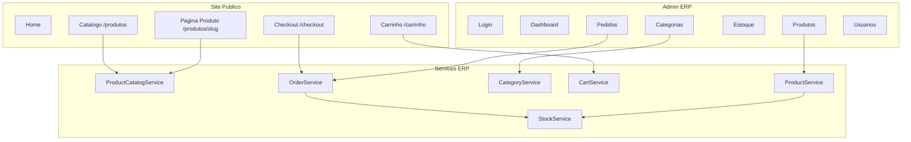

# 01 — Onboarding: o produto em 30 minutos

## O que o usuário vê

Dois produtos distintos no **mesmo projeto PHP**:

1. **Site público** — vitrine com catálogo, carrinho e checkout (`http://localhost/.../public/`)
2. **Painel admin ERP** — gestão de produtos, estoque, pedidos, usuários (`/admin/login`)

O cliente BMC Barros é apenas o **Tenant 1** (`ACTIVE_CLIENT=bmc`). O núcleo ERP não sabe que existe BMC.

## O que é este produto (em uma frase)

Um **ERP comercial reutilizável** com **loja online integrada**, preparado para servir vários clientes trocando configuração — não duplicando código.

## Os quatro contextos (mental model)

| Contexto | Pasta | Analogia |
|----------|-------|----------|
| **Core** | `core/` | Motor do carro — HTTP, router, banco, segurança base |
| **Erp** | `app/Erp/` | Painel e regras de negócio genéricas (produto de prateleira) |
| **Clients** | `app/Clients/` | Pintura e vitrine de cada loja (BMC, Demo) |
| **Shared** | `app/Shared/` | Ferramentas comuns (helpers, views de erro, resolver de cliente) |

Regra de ouro: **nada de marca de cliente dentro de `app/Erp/`**.

## Mapa de módulos



## Primeiro trace HTTP (exemplo rápido)

**Ação:** você acessa `/admin/dashboard` logado.

```
1. public/index.php          → ponto de entrada único
2. config/app.php            → autoload, .env, sessão
3. Core\App::run()           → captura Request, resolve rota
4. AuthMiddleware            → tem admin_id na sessão? SIM
5. AclMiddleware             → role admin pode /admin/dashboard? SIM
6. AdminController::dashboard → orquestra
7. DashboardService          → busca KPIs
8. View erp::dashboard/index → HTML
9. Response::send()          → browser recebe página
```

Se algo der errado **antes** do controller, você vê redirect (sem login) ou 403 (sem permissão) — nunca chega na view.

## Estrutura de pastas essencial

```text
bmc_barros/
├── public/index.php          ← única entrada HTTP
├── config/
│   ├── app.php               ← bootstrap
│   ├── routes.php            ← agrega rotas
│   ├── routes/erp.php        ← rotas admin
│   ├── routes/clients.php    ← delega ao cliente ativo
│   ├── middleware.php        ← grupos web / admin
│   └── acl.php               ← permissões por role
├── core/                     ← framework neutro
├── app/
│   ├── Erp/                  ← produto ERP
│   ├── Clients/Bmc|Demo/     ← sites por cliente
│   └── Shared/               ← utilitários
├── database/
│   ├── migrations/
│   ├── seeds/
│   └── schema/erp_product_full.sql
└── docs/guides/              ← este manual
```

## URLs importantes

| URL | O que faz |
|-----|-----------|
| `/` | Home do cliente ativo |
| `/produtos` | Catálogo público |
| `/produtos/:slug` | Página do produto |
| `/carrinho` | Carrinho |
| `/checkout` | Finalizar pedido online |
| `/admin/login` | Login admin |
| `/admin/dashboard` | Painel |
| `/admin/categorias` | CRUD categorias |
| `/admin/produtos` | CRUD produtos |
| `/admin/pedidos` | Gestão de pedidos |

## Variáveis de ambiente que importam

No `.env`:

| Variável | Função |
|----------|--------|
| `BASE_URL` | URL base do site (links, redirects) |
| `ACTIVE_CLIENT` | Cliente ativo (fallback): `bmc` ou `demo` |
| `TENANT_RESOLUTION` | `env` (padrão) ou `domain` — ver [deploy-multi-tenant.md](deploy-multi-tenant.md) |
| `DB_*` | Conexão MySQL |
| `SESSION_TIMEOUT` | Tempo máximo de inatividade admin |

## Onde NÃO mexer (ainda)

- SQL dentro de views
- Nome "BMC" ou "Barros" em `app/Erp/`
- Lógica de negócio complexa em controllers
- Microsserviços ou segundo front controller

## Checklist de compreensão

- [ ] Consigo explicar a diferença entre Core e Erp?
- [ ] Sei onde ficam rotas admin vs rotas públicas?
- [ ] Entendo que BMC é Cliente 1, não o produto?
- [ ] Sei que toda requisição passa por `public/index.php`?

## Exercício

1. Abra `public/index.php` e `config/app.php`.
2. Siga mentalmente até `Core\App::run()`.
3. Abra `config/routes/erp.php` e encontre a rota do dashboard.
4. Responda: **quantos middlewares rodam antes do controller do dashboard? Quais?**

<details>
<summary>Resposta</summary>

Dois middlewares do grupo `admin`: `AuthMiddleware` e `AclMiddleware` (ver `config/middleware.php`).

</details>

## Próximo passo

Leia [02-http-pipeline.md](02-http-pipeline.md) para o trace completo, passo a passo.

## Referência oficial

- [ARCHITECTURE.md](../../ARCHITECTURE.md) §1–3
- [PROJECT_CONTEXT.md](../PROJECT_CONTEXT.md) §1 e §7
