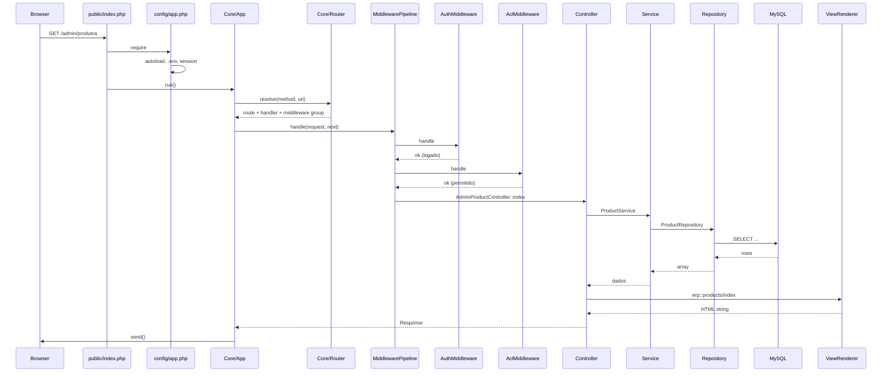

# 02 — Pipeline HTTP: da URL ao HTML

## O que o usuário vê

Qualquer página — admin ou pública — segue o **mesmo pipeline** até divergir no controller.

## Fluxo completo



## Arquivos na ordem de execução

| # | Arquivo | Responsabilidade |
|---|---------|------------------|
| 1 | `public/index.php` | Entrada única; registra handlers de erro; instancia `App` |
| 2 | `config/app.php` | Composer autoload, `.env`, constantes, sessão, `SessionGuard` |
| 3 | `core/App.php` | Orquestra request → route → middleware → handler → response |
| 4 | `core/Router.php` | Compara método + URI com rotas registradas |
| 5 | `config/routes.php` | Agrega `routes/clients.php` + `routes/erp.php` |
| 6 | `config/middleware.php` | Define grupos `web` e `admin` |
| 7 | Middlewares | Filtros antes do controller |
| 8 | Controller | Orquestra; chama service; renderiza view |
| 9 | Service | Regras de negócio |
| 10 | Repository | SQL via PDO |
| 11 | View | HTML (sem SQL) |
| 12 | `core/Response.php` | Envia status, headers e body |

## O que cada camada faz

### Controller (`app/Erp/Admin/Controllers/` ou `app/Clients/.../Controllers/`)

- Recebe a requisição já filtrada pelos middlewares.
- Chama **um ou mais services**.
- Passa dados para a view.
- **Não** deve conter SQL nem regras de negócio longas.

### Service (`app/Erp/{Modulo}/Services/`)

- Valida regras de negócio.
- Coordena repositories e transações quando necessário.
- Retorna arrays estruturados (`success`, `errors`, `data`).

### Repository (`app/Erp/{Modulo}/Repositories/`)

- **Única camada** que fala SQL com o banco (via `Core\Database`).
- Métodos como `find`, `listForAdmin`, `createOrder`.

### View (`app/Erp/Admin/Views/` ou `app/Clients/.../Site/Views/`)

- Recebe variáveis do controller.
- Renderiza HTML.
- Usa helpers como `url()`, `e()`, `csrf_field()`.

## Grupos de middleware

Definidos em `config/middleware.php`:

| Grupo | Middlewares | Usado em |
|-------|-------------|----------|
| `web` | (vazio) | Rotas públicas do site |
| `admin` | `AuthMiddleware` → `AclMiddleware` | Rotas `/admin/*` |

Cada rota declara `'middleware' => 'web'` ou `'admin'` no array de rotas.

### AuthMiddleware

- Se não logado e rota não é `/admin/login` → redirect para login.
- Chave de sessão: `$_SESSION['admin_id']`.

### AclMiddleware

- Se logado, verifica se a URI está em `config/acl.php` para a role do usuário.
- Se não → `ForbiddenException` (403).

## Como rotas são registradas

`config/routes.php`:

```php
$routeFiles = [
    __DIR__ . '/routes/clients.php',  // site público (cliente ativo)
    __DIR__ . '/routes/erp.php',      // admin ERP
];
```

Rotas de cliente vêm de `Shared\Support\Client::routesPath()` → ex.: `app/Clients/Bmc/routes.php`.

Formato de uma rota:

```php
[
    'method' => 'GET',
    'path' => '/admin/produtos',
    'handler' => [AdminProductController::class, 'index'],
    'middleware' => 'admin',
]
```

Parâmetros dinâmicos: `:id`, `:slug` — capturados pelo Router e passados ao método do controller.

## Renderização de views

Formato com contexto:

```php
$this->view('erp::products/index', $data, 'erp::layouts/admin');
$this->view('client::catalog/index', $data);
```

| Prefixo | Raiz física |
|---------|-------------|
| `erp::` | `app/Erp/Admin/Views/` |
| `client::` | `app/Clients/{ActiveClient}/Site/Views/` |
| `shared::` | `app/Shared/View/` |

## Tratamento de erros HTTP

`Core\App` captura exceções:

| Exceção | Código | View |
|---------|--------|------|
| `NotFoundException` | 404 | `shared::errors/404` |
| `ForbiddenException` | 403 | `shared::errors/403` |
| `UnauthorizedException` | 401 | — |
| Outras | 500 | `shared::errors/500` |

## Diferença: rota pública vs admin

| Aspecto | Pública (`web`) | Admin (`admin`) |
|---------|-----------------|-----------------|
| Rotas em | `app/Clients/Bmc/routes.php` | `config/routes/erp.php` |
| Controller | `Clients\Bmc\Site\Controllers\*` | `Erp\Admin\Controllers\*` |
| Middleware | Nenhum (grupo vazio) | Auth + ACL |
| Layout | View do cliente | `erp::layouts/admin` |
| CSS | `public/assets/clients/bmc/site/` | `public/assets/erp/admin/` |

## Onde NÃO mexer

- Lógica de roteamento espalhada em controllers
- `echo` direto no service (use return + view no controller)
- Bypass de middleware "só para testar" em produção

## Checklist ao debugar uma página

1. A rota existe? → `config/routes/erp.php` ou `Clients/.../routes.php`
2. Middleware bloqueou? → login (302) ou ACL (403)
3. Controller certo? → handler na rota
4. Service retorna o esperado? → log ou breakpoint
5. View recebe variáveis? → `$variavel ?? []` no topo da view

## Exercício

Trace **GET `/produtos`** (catálogo público):

1. Qual arquivo de rotas responde?
2. Qual controller e método?
3. Quantos middlewares rodam?
4. Qual service alimenta a listagem?

<details>
<summary>Resposta</summary>

1. `app/Clients/Bmc/routes.php` (via `config/routes/clients.php` e `ACTIVE_CLIENT=bmc`)
2. `Clients\Bmc\Site\Controllers\CatalogController::index`
3. Zero (grupo `web` vazio)
4. `Erp\Products\Services\ProductCatalogService` (chamado pelo CatalogController)

</details>

## Próximo passo

[03-contextos.md](03-contextos.md) — aprofunda Core, Erp, Clients e Shared com exemplos.

## Referência oficial

- [ARCHITECTURE.md](../../ARCHITECTURE.md) §3–5
