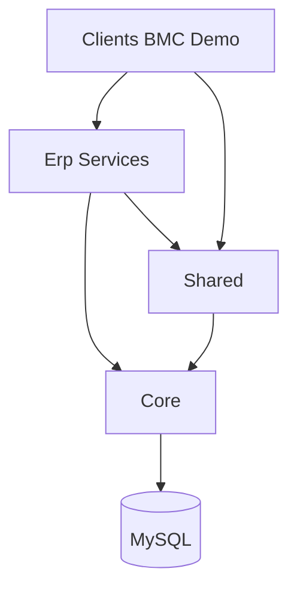

# 03 — Os quatro contextos: Core, Erp, Clients, Shared

## O que o usuário vê

O mesmo sistema parece "duas aplicações": loja bonita com marca BMC e painel admin genérico "ERP Admin". Por baixo, são **contextos separados** no código.

## Fluxo de dependência



**Regra:** Core nunca importa Erp ou Clients. Erp nunca importa Clients. Clients **consome** Erp.

## Core — o motor (`core/`)

**Namespace:** `Core\`

**O que é:** Framework mínimo próprio — equivalente ao "esqueleto" que Laravel/Symfony dariam, mas feito sob medida.

| Componente | Arquivo | Função |
|------------|---------|--------|
| App | `core/App.php` | Bootstrap da requisição |
| Router | `core/Router.php` | Mapeia URL → handler |
| Request/Response | `core/Request.php`, `Response.php` | HTTP abstrato |
| Database | `core/Database.php` | Singleton PDO |
| Repository base | `core/Database/Repository.php` | CRUD genérico |
| Middleware | `core/Middleware/*` | Pipeline de filtros |
| Security | `core/Security/*` | CSRF, SessionGuard, rate limit |
| Exceptions | `core/Exceptions/*` | 403, 404, validação |

**Proibido colocar aqui:** regra de produto, pedido, categoria, marca de cliente.

**Exemplo de uso correto:**

```php
// core/Middleware/AclMiddleware.php — genérico, lê config/acl.php
if (!$this->isAllowed($role, $request->uri())) {
    throw new ForbiddenException('...');
}
```

## Erp — o produto (`app/Erp/`)

**Namespace:** `Erp\`

**O que é:** Todo o negócio reutilizável — admin, catálogo, estoque, pedidos, carrinho.

Estrutura típica por domínio:

```text
app/Erp/
├── Admin/
│   ├── Controllers/     ← orquestração HTTP admin
│   └── Views/           ← templates admin
├── Products/
│   ├── Services/
│   └── Repositories/
├── Orders/
├── Commerce/
├── Stock/
├── Auth/
└── ...
```

**Exemplo:** `AdminCategoryController` chama `CategoryService` — nunca sabe se o site é BMC ou Demo.

**Proibido:** strings "BMC Barros", telefone do cliente, logo BMC, CSS do site público.

## Clients — cada loja (`app/Clients/`)

**Namespace:** `Clients\Bmc\`, `Clients\Demo\`

**O que é:** Implementação visual e de rotas públicas por tenant.

```text
app/Clients/Bmc/
├── Config/ClientConfig.php   ← nome, WhatsApp, assets, uploads
├── Site/
│   ├── Controllers/          ← Home, Catalog, Cart (thin wrappers)
│   └── Views/                ← HTML com marca BMC
└── routes.php                ← /, /produtos, /carrinho
```

**Padrão importante:** controllers de carrinho **estendem** o ERP:

```php
// app/Clients/Bmc/Site/Controllers/CartController.php
final class CartController extends PublicCartController {}
```

A lógica fica em `Erp\Commerce\Controllers\PublicCartController`; o cliente só herda.

**Responsabilidades do cliente:**

- textos institucionais e SEO da home
- layout e CSS (`public/assets/clients/bmc/site/`)
- rotas públicas
- links WhatsApp, endereço, telefone

## Shared — utilitários neutros (`app/Shared/`)

**Namespace:** `Shared\`

| Peça | Função |
|------|--------|
| `Support/Client.php` | Resolve cliente ativo (`ACTIVE_CLIENT`) |
| `View/` | Views de erro (403, 404, 500), partials de catálogo |
| Helpers em `app/Helpers/functions.php` | `url()`, `client_config()`, `catalog_filter_url()` |

**Exemplo:** trocar tenant no `.env`:

```dotenv
ACTIVE_CLIENT=demo
```

`Shared\Support\Client::key()` lê isso e carrega rotas/views de `Clients/Demo/`.

## Como decidir onde colocar código novo

| Pergunta | Se sim → |
|----------|----------|
| É HTTP genérico (router, CSRF base)? | `core/` |
| É regra de negócio ERP (produto, pedido)? | `app/Erp/` |
| É texto/logo/layout de um cliente? | `app/Clients/{Cliente}/` |
| É helper usado por ERP e Clients? | `app/Shared/` ou `app/Helpers/` |

## Namespaces e autoload

Composer PSR-4 (`composer.json`):

```text
Core\      → core/
Erp\       → app/Erp/
Clients\   → app/Clients/
Shared\    → app/Shared/
Database\  → database/
```

O namespace legado `App\` foi removido. Código novo usa os namespaces acima.

## Onde NÃO mexer

- Importar `Clients\Bmc` dentro de `Erp\Products\Services`
- Colocar SQL de produtos em `core/`
- Duplicar `CartService` em cada cliente

## Checklist ao alterar

- [ ] O código novo respeita a direção de dependência (Clients → Erp → Core)?
- [ ] Nenhuma referência a marca de cliente no Erp?
- [ ] View usa prefixo correto (`erp::` vs `client::`)?

## Exercício

1. Abra `app/Shared/Support/Client.php` e liste os clientes registrados.
2. Abra `app/Clients/Bmc/Config/ClientConfig.php` — o que é específico de BMC?
3. Abra `app/Erp/Products/Services/ProductCatalogService.php` — ele menciona BMC?

<details>
<summary>Resposta</summary>

1. `bmc` e `demo` no array `CLIENTS`.
2. Nome comercial, WhatsApp, paths de assets, uploads segmentados.
3. Não — service genérico; branding vem da view do cliente via `client_config()`.

</details>

## Próximo passo

- Multi-tenant na prática: [modules/clientes-tenant.md](modules/clientes-tenant.md)
- Banco de dados: [04-banco-de-dados.md](04-banco-de-dados.md)

## Referência oficial

- [ARCHITECTURE.md](../../ARCHITECTURE.md) §2, §6–7
- [PROJECT_CONTEXT.md](../PROJECT_CONTEXT.md) §1
