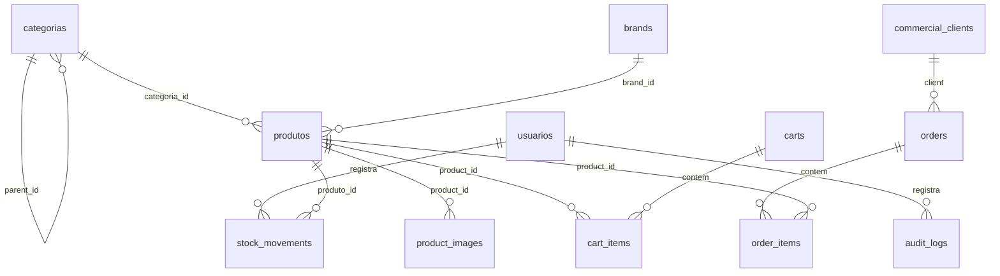

# 04 — Banco de dados: tabelas e quem escreve onde

## O que o usuário vê

Dados persistem entre reloads: produtos no catálogo, pedidos no admin, carrinho entre sessões. Tudo vive no MySQL (banco `erp_product` por padrão).

## Fonte de verdade do schema

| Recurso | Uso |
|---------|-----|
| `database/schema/erp_product_full.sql` | Instalação fresh (phpMyAdmin) |
| `database/migrations/` | Evolução incremental (`php migrate.php run`) |
| Tabela `migrations` | Controle de versões aplicadas |

**Regra:** código e migrations devem refletir o mesmo modelo. Após mudança estrutural, rode migrations antes de testar no browser.

## Diagrama simplificado de relações

## Tabelas por domínio

### Autenticação e admin

| Tabela | Escrita por | Leitura por |
|--------|-------------|-------------|
| `usuarios` | `UserRepository`, seed `criar_admin.php` | `AuthService`, `UserService` |
| `login_attempts` | `LoginRateLimiter` | `LoginRateLimiter` |
| `audit_logs` | `AuditLogRepository` via `AuditService` | `AdminAuditController` |

### Catálogo

| Tabela | Escrita por | Leitura por |
|--------|-------------|-------------|
| `categorias` | `CategoryRepository` / `CategoryService` | Admin + `CategoryRepository` vitrine |
| `brands` | `BrandRepository` | Catálogo, produtos |
| `produtos` | `ProductRepository` / `ProductService` | Admin, vitrine, carrinho, pedidos |
| `product_images` | `ProductRepository` | PDP, admin |
| `product_categories` | `ProductRepository::syncPrimaryCategory` | Futuro M:N |
| `attribute_definitions` | Migrations/seeds | Facetas catálogo |
| `attribute_options` | Seeds | Facetas |
| `product_attribute_values` | Seeds / futuro admin | `AttributeFacetRepository` |

### Estoque

| Tabela | Escrita por | Leitura por |
|--------|-------------|-------------|
| `stock_movements` | `StockMovementRepository` via `StockService` | `StockHistoryService`, relatórios |
| `produtos.estoque_atual` | **Sempre** via `StockService` | Todos módulos que exibem estoque |

### Comercial

| Tabela | Escrita por | Leitura por |
|--------|-------------|-------------|
| `commercial_clients` | `CommercialClientService`, checkout (`OrderService`) | Pedidos, relatórios |
| `orders` | `OrderRepository` via `OrderService` | Admin pedidos |
| `order_items` | `OrderItemRepository` | Detalhe pedido |

### Commerce (carrinho)

| Tabela | Escrita por | Leitura por |
|--------|-------------|-------------|
| `carts` | `CartRepository` via `CartService` | `CartService` |
| `cart_items` | `CartItemRepository` | Carrinho, checkout |

## Quem pode fazer SQL?

| Camada | SQL? |
|--------|------|
| Repository | **Sim** — único lugar ideal |
| Service | Não (usa repositories) |
| Controller | Não |
| View | **Nunca** |

Base: `core/Database/Repository.php` fornece helpers; repositories específicos estendem ou usam PDO.

## Conexão

- Singleton: `Core\Database::getInstance()`
- Config: `config/database.php` + variáveis `DB_*` no `.env`

## Seeds úteis

| Script | Função |
|--------|--------|
| `database/seeds/criar_admin.php` | Usuário admin inicial |
| `database/seeds/seed_catalog_mvp.php` | Categorias, marcas, 96 produtos demo |
| `database/seeds/seed_catalog_attributes.php` | Atributos Material/Uso |

## Status e enums importantes

| Campo | Valores comuns |
|-------|----------------|
| `produtos.status` | `ativo`, `inativo` |
| `categorias.status` | `active`, `inactive` |
| `orders.status` | `draft`, `confirmed`, `cancelled` |
| `stock_movements.type` | `entrada`, `saida`, `ajuste` |
| `usuarios.role` | `admin`, `operator` |

## Onde NÃO mexer

- Alterar `estoque_atual` com UPDATE solto no phpMyAdmin sem movimento correspondente
- Criar tabela só no SQL dump sem migration
- Queries na view para "agilizar"

## Checklist ao mudar schema

- [ ] Migration `up` e `down` criados
- [ ] `php migrate.php run` executado
- [ ] Repository e Service atualizados
- [ ] Seed ajustado se ambiente demo depende dele
- [ ] Guia [04-banco-de-dados.md](04-banco-de-dados.md) ou módulo atualizado

## Exercício

1. Qual tabela liga produto a pedido?
2. Quem é autorizado a alterar `produtos.estoque_atual`?
3. Onde está o histórico imutável de movimentações?

Resposta

1. `order_items` (FK `product_id`, `order_id` implícito via order).
2. `StockService` (via repositories) — não atualizar direto no controller.
3. `stock_movements`.

## Referência oficial

- [ARCHITECTURE.md](../../ARCHITECTURE.md) §10
- [database/schema/erp_product_full.sql](../../database/schema/erp_product_full.sql)
