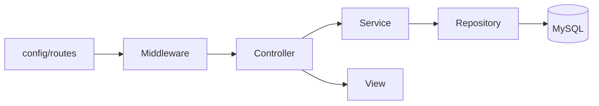

# 05 — Receita para nova feature (admin ou pública)

## O que o usuário vê

Você implementa uma tela nova — ela aparece no menu, mas dá 403. Ou funciona no admin mas quebra na vitrine. Este guia generaliza o checklist para **não esquecer nenhuma camada**.

## Checklist completo — tela admin nova

| # | Passo | Arquivo / pasta | Obrigatório? |
|---|-------|-----------------|--------------|
| 1 | Registrar rota | `config/routes/erp.php` | Sim |
| 2 | Liberar no ACL | `config/acl.php` | Sim (rotas admin) |
| 3 | Controller | `app/Erp/Admin/Controllers/Admin*Controller.php` | Sim |
| 4 | Service | `app/Erp/{Dominio}/Services/*Service.php` | Sim (regras) |
| 5 | Repository | `app/Erp/{Dominio}/Repositories/*Repository.php` | Se usa banco |
| 6 | Views | `app/Erp/Admin/Views/{modulo}/` | Sim |
| 7 | Menu sidebar | `app/Erp/Admin/Views/partials/admin-sidebar.php` | UX |
| 8 | Migration | `database/migrations/` + `php migrate.php run` | Se tabela/coluna nova |
| 9 | Seed (opcional) | `database/seeds/` | Dados iniciais |
| 10 | ACL operator | `config/acl.php` role `operator` | Se operador usa |
| 11 | Auditoria | `AuditService::record()` em ações críticas | Recomendado |
| 12 | Teste | `tests/Unit/` ou `tests/Feature/` | Recomendado |
| 13 | CSRF | `Csrf::requireValidPostOrAbort()` em POSTs | Sim |
| 14 | Doc guia | `docs/guides/modules/` | Manutenção |

## Checklist — feature pública (site cliente)

| # | Passo | Arquivo |
|---|-------|---------|
| 1 | Rota | `app/Clients/{Cliente}/routes.php` |
| 2 | Controller | `app/Clients/{Cliente}/Site/Controllers/` ou estender controller ERP |
| 3 | Service | Preferir reutilizar `app/Erp/` (não duplicar) |
| 4 | View | `app/Clients/{Cliente}/Site/Views/` com prefixo `client::` |
| 5 | Assets | `public/assets/clients/{cliente}/site/` |
| 6 | Config | `ClientConfig.php` se precisar de texto/asset novo |

Rotas públicas usam `'middleware' => 'web'` (sem auth/ACL).

## Template mental de camadas



**Controller:** fino — recebe POST, chama service, escolhe view ou redirect.

**Service:** retorna estrutura padronizada:

```php
return [
    'success' => false,
    'errors' => ['Campo X inválido.'],
    'data' => $formData,
    'message' => '...',
];
```

**Repository:** SQL isolado; estende `Core\Database\Repository` quando CRUD simples.

## Exemplo mínimo — nova rota admin GET

**1. Rota** (`config/routes/erp.php`):

```php
['method' => 'GET', 'path' => '/admin/meu-modulo', 'handler' => [AdminMeuController::class, 'index'], 'middleware' => 'admin'],
```

**2. ACL** (`config/acl.php`):

```php
'/admin/meu-modulo*',
```

**3. Controller:**

```php
public function index(): void
{
    $this->view('erp::meu-modulo/index', [
        'tituloPagina' => 'Meu Módulo',
        'paginaAtiva' => 'meu-modulo',
        'items' => $this->service->listForAdmin(),
    ], 'erp::layouts/admin');
}
```

## Migration — quando e como

1. Crie arquivo em `database/migrations/` com timestamp.
2. Implemente `up()` e `down()`.
3. Execute: `php migrate.php run`
4. Atualize `database/schema/erp_product_full.sql` apenas em releases formais (opcional).

**Nunca** altere banco manualmente no phpMyAdmin sem migration correspondente — você perde rastreabilidade.

## Testes úteis

| Tipo | O que testar |
|------|--------------|
| Middleware | ACL bloqueia/libera URI |
| Service | Regra de negócio (validação, estoque) |
| Feature | Fluxo HTTP com banco SQLite em memória |

Rodar: `vendor/bin/phpunit tests/Unit/NomeTest.php`

## Erros clássicos ao criar feature

| Sintoma | Causa provável | Onde olhar |
|---------|----------------|------------|
| 403 logado | Falta ACL | `config/acl.php` |
| 404 | Rota não registrada ou typo na URL | `config/routes/erp.php` |
| Redirect login | Middleware admin sem sessão | Login / `AuthMiddleware` |
| Página em branco | Erro PHP | `storage/logs/php_error.log` |
| SQL error | Migration não rodou | `php migrate.php run` |
| View not found | Prefixo errado (`erp::` vs `client::`) | Controller `view()` |

## Onde NÃO mexer

- SQL na view
- Lógica de negócio só no controller (extraia para service)
- Esquecer CSRF em formulários POST admin

## Exercício

Você vai criar `/admin/marcas` (CRUD de marcas). Liste **na ordem** os 8 arquivos/pastas que tocaria antes de testar no browser.

<details>
<summary>Sugestão de resposta</summary>

1. Migration `brands` (se ainda não existir — já existe no schema atual)
2. `BrandRepository` / `BrandService` (já existem parcialmente)
3. `AdminBrandController`
4. Views em `app/Erp/Admin/Views/brands/`
5. Rotas em `config/routes/erp.php`
6. ACL em `config/acl.php`
7. Item no `admin-sidebar.php`
8. Teste unitário do service ou ACL

</details>

## Referência oficial

- [ARCHITECTURE.md](../../ARCHITECTURE.md) §4–6
- [modules/usuarios-acl.md](modules/usuarios-acl.md)
