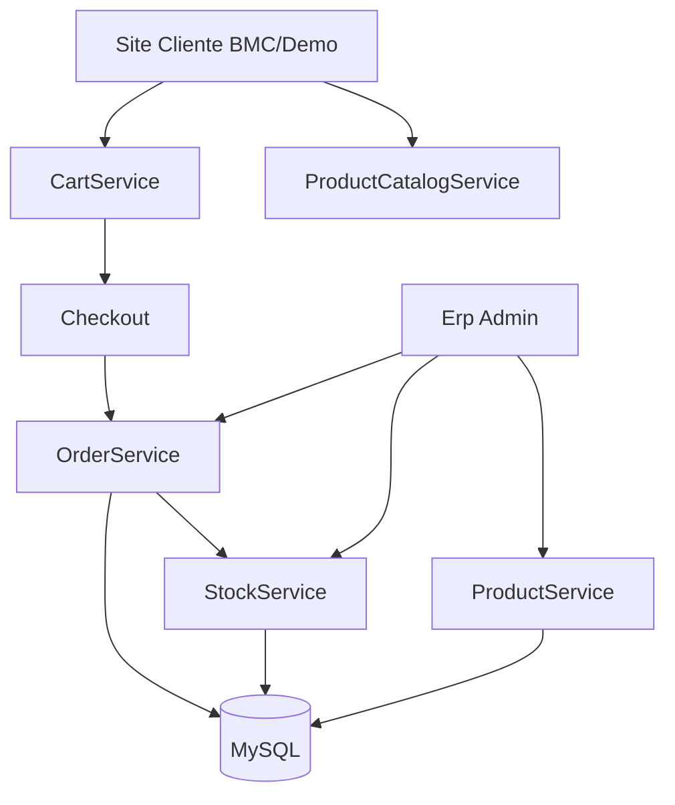

# Manual de Aprendizado — ERP Produto

> Trilha pedagógica para entender **como o produto funciona**, não só como rodá-lo.  
> Complementa (não substitui) [ARCHITECTURE.md](../../ARCHITECTURE.md) e [PROJECT_CONTEXT.md](../PROJECT_CONTEXT.md).

## Para quem é este manual

- Você é dev jr e quer **entender seu produto comercial** antes de evoluí-lo.
- Você prefere aprender **rastreando uma ação concreta** (clicar em Categorias, aprovar pedido) até o banco.
- Você já sabe PHP básico, mas quer clareza sobre **onde cada coisa mora** neste projeto.

## Como usar

1. Leia os guias **na ordem numérica** na primeira passada.
2. Depois consulte `modules/` quando precisar de um módulo específico.
3. Faça os **exercícios** no final de cada guia (sem olhar a resposta de imediato).
4. Quando criar algo novo, use [05-receita-nova-feature.md](05-receita-nova-feature.md).

## Roteiro de estudo (10 dias)

| Dia | Guia | Resultado esperado |
|-----|------|-------------------|
| 1–2 | [01-onboarding.md](01-onboarding.md) + [02-http-pipeline.md](02-http-pipeline.md) | Explicar o caminho de uma requisição sem abrir código |
| 3–4 | [03-contextos.md](03-contextos.md) + [modules/clientes-tenant.md](modules/clientes-tenant.md) | Saber por que BMC está em `Clients/` e produto em `Erp/` |
| 5–6 | [modules/produtos-categorias.md](modules/produtos-categorias.md) + [04-banco-de-dados.md](04-banco-de-dados.md) | Rastrear CRUD de produto do admin à vitrine |
| 7–8 | [modules/commerce-carrinho.md](modules/commerce-carrinho.md) + [modules/pedidos.md](modules/pedidos.md) | Entender fluxo site → pedido → estoque |
| 9 | [05-receita-nova-feature.md](05-receita-nova-feature.md) | Saber onde criar módulo novo sem esquecer ACL |
| 10 | [06-troubleshooting.md](06-troubleshooting.md) + exercícios pendentes | Diagnosticar erros sozinho |

## Índice de guias

### Fundamentos

| Arquivo | Conteúdo |
|---------|----------|
| [01-onboarding.md](01-onboarding.md) | O que é o produto, mapa de módulos, primeiro trace HTTP |
| [02-http-pipeline.md](02-http-pipeline.md) | Da URL ao HTML: index → Router → Middleware → camadas |
| [03-contextos.md](03-contextos.md) | Core, Erp, Clients, Shared — com exemplos reais |
| [04-banco-de-dados.md](04-banco-de-dados.md) | Tabelas, relações e quem escreve onde |
| [05-receita-nova-feature.md](05-receita-nova-feature.md) | Checklist ao criar tela ou módulo admin |
| [06-troubleshooting.md](06-troubleshooting.md) | 403, migrations, sessão, BASE_URL e erros comuns |
| [deploy-multi-tenant.md](deploy-multi-tenant.md) | Vhosts, `TENANT_RESOLUTION=domain`, deploy multi-site |

### Módulos de negócio

| Arquivo | Conteúdo |
|---------|----------|
| [modules/auth.md](modules/auth.md) | Login, sessão, rate limit, logout |
| [modules/usuarios-acl.md](modules/usuarios-acl.md) | Roles, ACL e o caso clássico do 403 |
| [modules/produtos-categorias.md](modules/produtos-categorias.md) | CRUD admin + vitrine pública |
| [modules/estoque.md](modules/estoque.md) | Movimentações, histórico, inventário rápido |
| [modules/commerce-carrinho.md](modules/commerce-carrinho.md) | Carrinho persistente e checkout |
| [modules/pedidos.md](modules/pedidos.md) | Pedidos admin/online, aprovação e baixa de estoque |
| [modules/clientes-tenant.md](modules/clientes-tenant.md) | Multi-cliente, ACTIVE_CLIENT, branding |

## Mapa rápido de módulos

## Módulos implementados (AS-IS)

| Módulo | Contexto | Guia |
|--------|----------|------|
| Autenticação Admin | ERP | [auth.md](modules/auth.md) |
| Dashboard | ERP | (usa pipeline geral) |
| Produtos + Categorias | ERP | [produtos-categorias.md](modules/produtos-categorias.md) |
| Estoque | ERP | [estoque.md](modules/estoque.md) |
| Catálogo Público | Clients | [produtos-categorias.md](modules/produtos-categorias.md) |
| Carrinho + Checkout | ERP Commerce | [commerce-carrinho.md](modules/commerce-carrinho.md) |
| Pedidos | ERP | [pedidos.md](modules/pedidos.md) |
| Usuários + ACL | ERP + Core | [usuarios-acl.md](modules/usuarios-acl.md) |
| Clientes comerciais | ERP | [pedidos.md](modules/pedidos.md) |
| Relatórios | ERP | — |
| Auditoria | ERP | — |
| Multi-tenant | Clients + Shared | [clientes-tenant.md](modules/clientes-tenant.md) |

## Manutenção deste manual

Ao terminar um módulo novo no código:

1. Atualize o guia correspondente em `docs/guides/modules/`.
2. Atualize a tabela acima neste README.
3. Atualize `## Last Update` em [PROJECT_CONTEXT.md](../PROJECT_CONTEXT.md).

## Documentação oficial (referência)

- [ARCHITECTURE.md](../../ARCHITECTURE.md) — fluxo HTTP e critérios arquiteturais
- [PROJECT_CONTEXT.md](../PROJECT_CONTEXT.md) — estado real do produto, sprints e próximos passos
- [PHASE_C_BACKLOG.md](../PHASE_C_BACKLOG.md) — registro da Fase C e evoluções pendentes
