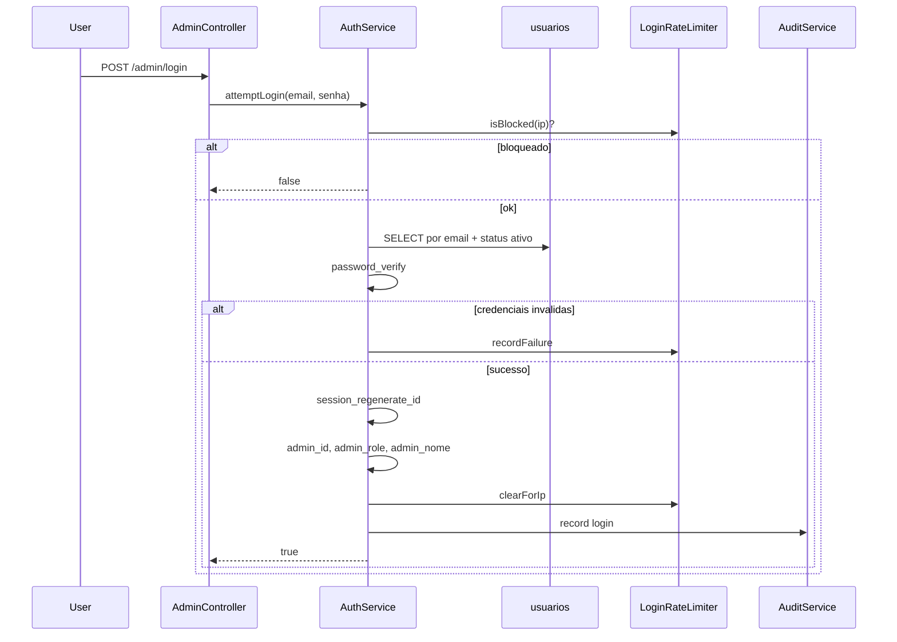

# Módulo — Autenticação Admin

## O que o usuário vê

- **GET `/admin/login`** — formulário e-mail/senha
- Após login válido → redirect para `/admin/dashboard`
- **GET `/admin/logout`** — encerra sessão
- Sessão expira por inatividade (`SESSION_TIMEOUT` no `.env`)

## Fluxo de login



## Arquivos na ordem

| # | Arquivo |
|---|---------|
| 1 | `config/routes/erp.php` — rotas login/logout |
| 2 | `core/Middleware/AuthMiddleware.php` — `/admin/login` é rota guest |
| 3 | `app/Erp/Admin/Controllers/AdminController.php` — `login`, `authenticate`, `logout` |
| 4 | `app/Erp/Auth/Services/AuthService.php` — lógica de autenticação |
| 5 | `app/Erp/Auth/Repositories/UsuarioRepository.php` — acesso a `usuarios` |
| 6 | `core/Security/LoginRateLimiter.php` — proteção brute force |
| 7 | `core/Security/Csrf.php` — token no POST login |
| 8 | `core/Security/SessionGuard.php` — timeout em `config/app.php` |

## Chaves de sessão admin

```text
admin_id      → ID do usuário logado
admin_nome    → Nome exibido no topbar
admin_role    → Papel para ACL (admin, operator)
last_activity → Timestamp para SessionGuard
csrf          → Token CSRF
```

## O que cada camada faz

- **AdminController:** exibe form, chama `AuthService`, redirect
- **AuthService:** valida credenciais, popula sessão, audita login/logout
- **LoginRateLimiter:** limita tentativas por IP (`login_attempts`)
- **SessionGuard:** encerra sessão se inativo além do timeout

## Segurança implementada

| Mecanismo | Onde |
|-----------|------|
| `password_hash` / `password_verify` | `AuthService`, seed `criar_admin.php` |
| Regeneração de session ID no login | `AuthService::attemptLogin` |
| Rate limit por IP | `LoginRateLimiter` |
| CSRF em POSTs | `Csrf::requireValidPostOrAbort()` |
| Cookie HttpOnly, SameSite Strict | `config/app.php` |

## Onde NÃO mexer

- Armazenar senha em texto plano
- Desabilitar rate limit "temporariamente" em produção
- Confiar só no front-end para proteger rotas admin (middleware é obrigatório)

## Checklist ao alterar auth

- [ ] POST de login valida CSRF?
- [ ] Novas rotas admin usam middleware `admin`?
- [ ] Logout limpa sessão e cookie?

## Exercício

1. O que acontece se você acessar `/admin/dashboard` **sem** `admin_id` na sessão?
2. Onde a role do usuário é gravada após login?
3. Qual tabela registra tentativas falhas de login?

<details>
<summary>Resposta</summary>

1. `AuthMiddleware` redireciona para `/admin/login` (302).
2. `$_SESSION['admin_role']` em `AuthService::attemptLogin`, vindo de `usuarios.role`.
3. `login_attempts`.

</details>

## Referência oficial

- [ARCHITECTURE.md](../../ARCHITECTURE.md) §11
