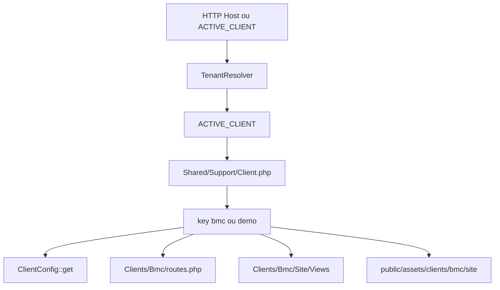

# Módulo — Clientes e Multi-Tenant

## O que o usuário vê

- Com `ACTIVE_CLIENT=bmc` → site BMC Barros (cores, textos, WhatsApp BMC)
- Com `ACTIVE_CLIENT=demo` → site demonstrativo genérico
- **Admin ERP é o mesmo** nos dois casos — não muda com o tenant

## Conceito de tenant neste produto

O multi-tenant suporta dois modos:

| Modo | Variável | Uso |
|------|----------|-----|
| **Por `.env`** (padrão) | `TENANT_RESOLUTION=env` | Um tenant por instalação; troca via `ACTIVE_CLIENT` |
| **Por domínio** | `TENANT_RESOLUTION=domain` | BMC e Demo simultâneos em hosts diferentes |

Em ambos os casos:

- Dados ERP compartilhados no mesmo banco
- Branding e rotas públicas separados por pasta em `app/Clients/`
- Admin ERP é o mesmo para todos os tenants

Deploy multi-domínio: [deploy-multi-tenant.md](../deploy-multi-tenant.md).

## Fluxo — resolver cliente ativo

## Arquivos essenciais

| Peça | Arquivo |
|------|---------|
| Mapa host → tenant | `config/tenants.php` |
| Resolver bootstrap | `app/Shared/Support/TenantResolver.php` |
| Resolver cliente | `app/Shared/Support/Client.php` |
| Config BMC | `app/Clients/Bmc/Config/ClientConfig.php` |
| Config Demo | `app/Clients/Demo/Config/ClientConfig.php` |
| Rotas agregadas | `config/routes/clients.php` → `Client::routesPath()` |
| Rotas BMC | `app/Clients/Bmc/routes.php` |
| Assets BMC | `public/assets/clients/bmc/site/` |
| Uploads | `public/uploads/clients/bmc/products/` |

## ClientConfig — o que contém

Typical keys (consulte o arquivo real):

- `name`, `legalName` — nomes comerciais
- `whatsappNumber`, `phone`, `address`
- `assets.base` — path CSS/JS público
- `uploads.products` — path uploads de imagem

Helper global: `client_config()` em `app/Helpers/functions.php`.

## Registrar novo cliente (resumo)

1. Pasta `app/Clients/NovoCliente/` com Config, Site, routes.php
2. Registrar em `Shared\Support\Client::CLIENTS`
3. Assets em `public/assets/clients/novo-cliente/site/`
4. Registrar host em `config/tenants.php` (modo domain)
5. `.env`: `ACTIVE_CLIENT=novo-cliente` (fallback)

Detalhes: [README.md](../../README.md) seção "Criar Novo Cliente".

## Clientes comerciais vs tenant

**Não confundir:**

| Termo | O que é |
|-------|---------|
| **Tenant / Cliente implementação** | BMC, Demo — pasta em `app/Clients/` |
| **Cliente comercial** | Comprador cadastrado em `commercial_clients` (ERP) |

Pedidos online **criam** registro em `commercial_clients` no checkout.

## O que cada camada faz

- **Client.php:** mapa estático de tenants; resolve config, rotas, assets
- **ClientConfig:** array PHP com branding (sem banco)
- **Site Controllers:** finos; delegam services ERP
- **Site Views:** HTML + `client_config()` para textos

## Onde NÃO mexer

- Referência a BMC dentro de `app/Erp/`
- Duplicar services ERP por cliente
- Hardcodar `ACTIVE_CLIENT` no código (use `.env`)

## Checklist ao adicionar tenant

- [ ] Registrado em `Client::CLIENTS`?
- [ ] `routes.php` com rotas espelhadas (home, produtos, carrinho)?
- [ ] Views `client::` mínimas (home, catalog, commerce)?
- [ ] Assets e uploads paths no ClientConfig?
- [ ] Host registrado em `config/tenants.php` (se domain)?
- [ ] Testado troca `ACTIVE_CLIENT` no `.env` ou hosts `bmc.local` / `demo.local`?

## Exercício

1. O admin muda quando você troca `ACTIVE_CLIENT` de `bmc` para `demo`?
2. Onde está o número de WhatsApp exibido no site?
3. Qual arquivo decide qual `routes.php` carregar?

Resposta

1. Não — admin ERP é independente do tenant do site.
2. `ClientConfig` do cliente ativo, via `client_config()` nas views.
3. `Shared\Support\Client::routesPath()`.

## Referência oficial

- [ARCHITECTURE.md](../../ARCHITECTURE.md) §7–9
- [README.md](../../README.md)
