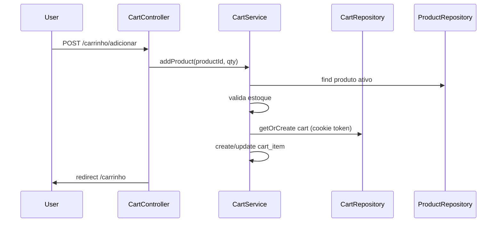
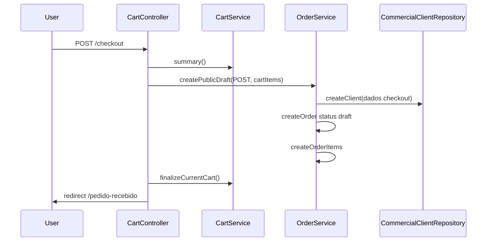

# Módulo — Carrinho e Checkout (Commerce)

## O que o usuário vê

- **`/carrinho`** — itens adicionados, quantidades, total
- **`/checkout`** — formulário de dados do cliente (nome, e-mail, telefone, endereço)
- Após enviar → pedido criado como **rascunho** (`draft`), carrinho esvaziado, redirect para **`/pedido-recebido`**

## Fluxo — adicionar ao carrinho

## Fluxo — checkout (pedido online)

## Arquivos na ordem

| # | Arquivo |
|---|---------|
| 1 | `app/Clients/Bmc/routes.php` — rotas `/carrinho*`, `/checkout`, `/pedido-recebido` |
| 2 | `app/Clients/Bmc/Site/Controllers/CartController.php` — extends ERP |
| 3 | `app/Erp/Commerce/Controllers/PublicCartController.php` — lógica compartilhada |
| 4 | `app/Erp/Commerce/Services/CartService.php` |
| 5 | `app/Erp/Commerce/Repositories/CartRepository.php` |
| 6 | `app/Erp/Commerce/Repositories/CartItemRepository.php` |
| 7 | `app/Erp/Orders/Services/OrderService.php` — `createPublicDraft()` |
| 8 | Views | `app/Clients/Bmc/Site/Views/commerce/cart.php`, `checkout.php`, `order-received.php` |

## Persistência do carrinho

- Cookie `cart_token` (30 dias) identifica o carrinho anônimo.
- Tabelas: `carts`, `cart_items`
- Carrinho vincula `product_id`, `quantity`, `unit_price` (preço no momento da adição)

**Importante:** preço congelado no item do carrinho; se admin mudar preço depois, item mantém valor original até atualizar quantidade.

## O que cada camada faz

**CartController (cliente):** classe vazia que herda `PublicCartController` — padrão para reutilizar commerce em Demo/BMC.

**PublicCartController:**
- `index` — exibe carrinho
- `add/update/remove` — CSRF + CartService
- `checkout` / `placeOrder` — formulário e criação do pedido

**CartService:**
- Valida produto ativo e estoque
- Gerencia cookie e sessão do carrinho
- `finalizeCurrentCart()` após pedido bem-sucedido

**OrderService::createPublicDraft():**
- Reutiliza `commercial_clients` existente por e-mail ou CPF/CNPJ (`findOrCreate`)
- Usa `unit_price` congelado do carrinho nos itens do pedido
- Cria `orders` com status `draft` e nota prefixada "Pedido online recebido pelo site público."
- Cria `order_items`
- **Não baixa estoque** (aprovação manual depois)

## Segurança

- CSRF em todos os POSTs (`Csrf::requireValidPostOrAbort()`)
- Rotas públicas — sem ACL, mas validação no service

## Onde NÃO mexer

- Duplicar `CartService` em `Clients/Bmc`
- Baixar estoque no `placeOrder` (quebra fluxo de aprovação admin)
- SQL de carrinho na view

## Checklist ao alterar commerce

- [ ] Demo também herda `PublicCartController`?
- [ ] Views `client::commerce/*` existem em BMC e Demo?
- [ ] Migrations `carts` / `cart_items` aplicadas?
- [ ] Mensagens flash usam `commerce_message` na sessão

## Exercício

1. Onde fica a lógica real do carrinho — BMC ou Erp?
2. O pedido online nasce com qual status?
3. O que acontece com o cookie/token após checkout bem-sucedido?

Resposta

1. `Erp\Commerce` — BMC só declara rotas e herda controller.
2. `draft`.
3. `CartService::finalizeCurrentCart()` encerra carrinho atual; novo carrinho na próxima compra.

## Referência oficial

- [modules/pedidos.md](pedidos.md)
- [PROJECT_CONTEXT.md](../../PROJECT_CONTEXT.md) §7
