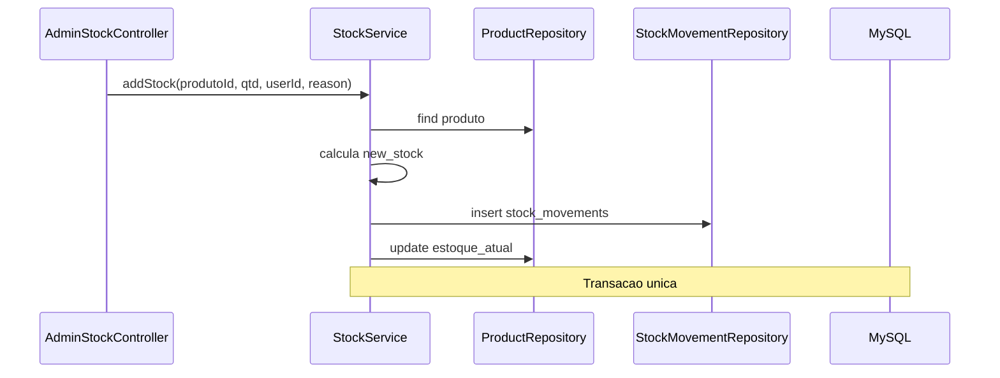

# Módulo — Estoque

## O que o usuário vê

**Admin:**
- `/admin/estoque` — histórico de movimentações (entrada, saída, ajuste)
- Formulários em `/admin/produtos` — entrada/saída/ajuste por produto
- `/admin/inventario-rapido` — ajuste em lote de vários produtos

**Efeito colateral:** pedido aprovado também baixa estoque (via `StockService`).

## Fluxo — entrada de estoque



## Arquivos na ordem

| Camada | Arquivo |
|--------|---------|
| Controllers | `AdminStockController`, `AdminStockHistoryController`, `AdminQuickInventoryController` |
| Service | `app/Erp/Stock/Services/StockService.php` |
| Histórico | `app/Erp/Stock/Services/StockHistoryService.php` |
| Repository | `app/Erp/Stock/Repositories/StockMovementRepository.php` |
| Views | `app/Erp/Admin/Views/stock/` |
| Rotas | `/admin/estoque`, `/admin/produtos/:id/entrada|saida|ajuste`, `/admin/inventario-rapido` |

## Tipos de movimentação

| Tipo | Método StockService | Efeito em `produtos.estoque_atual` |
|------|---------------------|-----------------------------------|
| `entrada` | `addStock()` | Incrementa |
| `saida` | `removeStock()` | Decrementa (valida mínimo zero) |
| `ajuste` | `adjustStock()` | Define valor absoluto |

Cada operação grava linha em `stock_movements` com:
- `previous_stock`, `new_stock`, `quantity`
- `user_id` (admin que executou)
- `reason` (texto livre ou gerado, ex.: "Pedido #5 aprovado")

## Integração com pedidos

Quando admin **aprova** pedido (`OrderService::approve`):

```php
foreach ($items as $item) {
    $this->stockService->removeStock(
        (int) $item['product_id'],
        (int) $item['quantity'],
        $userId,
        'Pedido #' . $orderId . ' aprovado'
    );
}
```

Pedido online nasce como `draft` — **estoque NÃO baixa** até aprovação manual.

## O que cada camada faz

- **StockService:** transação, validação, atualiza produto + movimento
- **StockHistoryService:** listagem paginada/filtrada para tela de histórico
- **StockMovementRepository:** INSERT/SELECT em `stock_movements`
- **Controllers:** recebem POST, CSRF, chamam service, redirect com feedback

## Onde NÃO mexer

- Atualizar `estoque_atual` direto no repository sem passar por `StockService`
- Abrir transação no repository (transação fica no service)
- Baixar estoque no checkout público (regra atual: só na aprovação)

## Checklist ao alterar estoque

- [ ] Toda alteração passa por `StockService`?
- [ ] Movimento registrado em `stock_movements`?
- [ ] POST protegido com CSRF?
- [ ] ACL liberado para `/admin/inventario-rapido*` se usar inventário rápido?

## Exercício

1. O que impede estoque negativo?
2. Quando um pedido online baixa estoque?
3. Qual tabela guarda o histórico auditável de movimentações?

<details>
<summary>Resposta</summary>

1. `StockService::removeStock()` lança `ValidationException` se `previous < quantidade`.
2. Quando admin aprova (`POST /admin/pedidos/:id/aprovar`), não no checkout.
3. `stock_movements`.

</details>

## Referência oficial

- [ARCHITECTURE.md](../../ARCHITECTURE.md) §10
- [modules/pedidos.md](pedidos.md)
