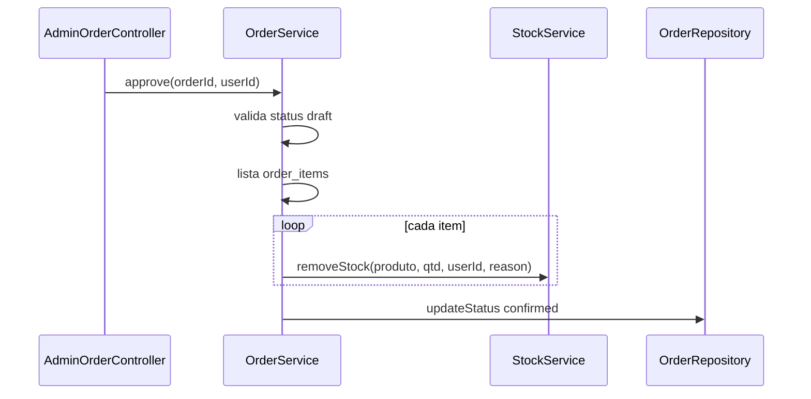

# Módulo — Pedidos

## O que o usuário vê

**Admin:**
- `/admin/pedidos` — lista (origem Site ou Admin)
- `/admin/pedidos/criar` — pedido manual (1 produto)
- `/admin/pedidos/:id` — detalhe com itens
- Ações: **Aprovar** (baixa estoque) / **Cancelar**

**Site:** checkout cria pedido online automaticamente (ver [commerce-carrinho.md](commerce-carrinho.md)).

## Status de pedido

| Status | Significado |
|--------|-------------|
| `draft` | Rascunho — pedido online aguardando análise |
| `confirmed` | Confirmado — estoque baixado |
| `cancelled` | Cancelado — não pode aprovar |

## Fluxo — aprovar pedido online

## Arquivos na ordem

| Camada | Arquivo |
|--------|---------|
| Controller | `app/Erp/Admin/Controllers/AdminOrderController.php` |
| Service | `app/Erp/Orders/Services/OrderService.php` |
| Repositories | `OrderRepository`, `OrderItemRepository` |
| Clientes | `CommercialClientRepository` |
| Views | `app/Erp/Admin/Views/orders/` |
| Rotas | `/admin/pedidos*` em `config/routes/erp.php` |

## Origem do pedido (Site vs Admin)

`OrderService::resolveOrigin()` inspeciona o campo `notes`:

- Se começa com `"Pedido online recebido pelo site público."` → origem **online**
- Caso contrário → origem **admin**

Exibido no detalhe como "Site público" ou "Admin ERP".

## Pedido admin vs pedido online

| Aspecto | Admin (`create`) | Online (`createPublicDraft`) |
|---------|------------------|------------------------------|
| Cliente | Seleciona existente | Cria `commercial_clients` no checkout |
| Itens | 1 produto por vez (MVP) | Todos itens do carrinho |
| Status inicial | `draft` ou `confirmed` | Sempre `draft` |
| Baixa estoque | Se criado já `confirmed` | Só na aprovação |

## Tabelas

| Tabela | Conteúdo |
|--------|----------|
| `orders` | Cabeçalho: cliente, total, status, notes |
| `order_items` | product_id, quantity, unit_price |
| `commercial_clients` | Dados do comprador |

## O que cada camada faz

- **AdminOrderController:** listagem, formulário, show, approve, cancel
- **OrderService:** transações, validação, integração estoque
- **OrderRepository:** SQL orders
- **OrderItemRepository:** SQL itens

## Onde NÃO mexer

- Baixar estoque no controller (service + StockService)
- Aprovar pedido cancelado (service valida)
- Ignorar transação PDO em operações multi-tabela

## Checklist ao alterar pedidos

- [ ] Aprovação passa por `OrderService::approve`?
- [ ] Cancelamento não baixa estoque duas vezes?
- [ ] ACL `/admin/pedidos*` para roles corretas?
- [ ] Auditoria em ações críticas (se aplicável)

## Exercício

1. Quando o estoque baixa em um pedido **online**?
2. Qual campo identifica pedido vindo do site?
3. O que impede aprovar pedido já cancelado?

Resposta

1. No `POST /admin/pedidos/:id/aprovar` → `OrderService::approve()` → `StockService::removeStock()` por item.
2. Prefixo em `orders.notes` ("Pedido online recebido...").
3. `approve()` retorna erro se `status === 'cancelled'`.

## Referência oficial

- [modules/estoque.md](estoque.md)
- [modules/commerce-carrinho.md](commerce-carrinho.md)
