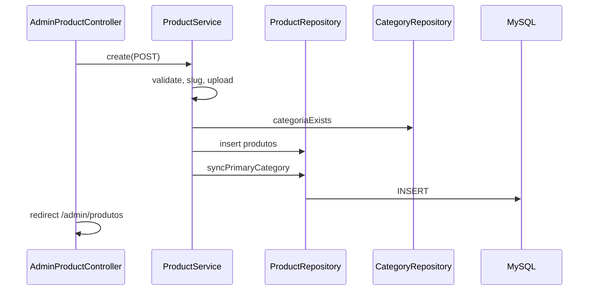
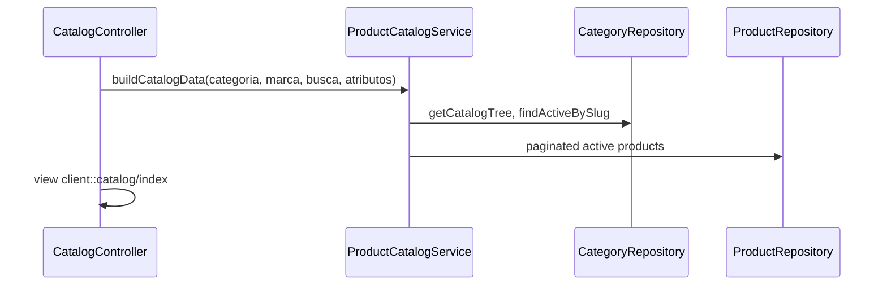

# Módulo — Produtos e Categorias

## O que o usuário vê

**Admin:**
- `/admin/categorias` — árvore hierárquica (até 3 níveis)
- `/admin/produtos` — CRUD com categoria, imagem, estoque, status

**Site público:**
- `/produtos` — vitrine com filtros (categoria, marca, atributos)
- `/produtos/:slug` — página individual do produto (PDP)

## Fluxo admin — criar produto

## Fluxo público — listar catálogo

## Arquivos principais

### Admin — Categorias

| Camada | Arquivo |
|--------|---------|
| Controller | `app/Erp/Admin/Controllers/AdminCategoryController.php` |
| Service | `app/Erp/Products/Services/CategoryService.php` |
| Repository | `app/Erp/Products/Repositories/CategoryRepository.php` |
| Views | `app/Erp/Admin/Views/categories/` |
| Rotas | `config/routes/erp.php` — `/admin/categorias*` |
| ACL | `config/acl.php` — `/admin/categorias*` |

### Admin — Produtos

| Camada | Arquivo |
|--------|---------|
| Controller | `app/Erp/Admin/Controllers/AdminProductController.php` |
| Service | `app/Erp/Products/Services/ProductService.php` |
| Repository | `app/Erp/Products/Repositories/ProductRepository.php` |
| Views | `app/Erp/Admin/Views/products/` |
| Uploads | `public/uploads/clients/{client}/products/` |

### Vitrine pública

| Camada | Arquivo |
|--------|---------|
| Controller | `app/Clients/Bmc/Site/Controllers/CatalogController.php` |
| Service | `app/Erp/Products/Services/ProductCatalogService.php` |
| View | `app/Clients/Bmc/Site/Views/catalog/index.php` |
| Partial compartilhado | `app/Shared/View/catalog/sidebar-nav.php` |
| Rotas | `app/Clients/Bmc/routes.php` — `/produtos`, `/produtos/:slug` |

## O que cada camada faz

**CategoryService:**
- Valida hierarquia (máx. 3 níveis)
- Impede excluir categoria com filhos ou produtos
- Gera slug via `CatalogSlug`

**ProductService:**
- CRUD admin, upload de imagem segmentado por cliente
- Valida categoria ativa e estoque inicial

**ProductCatalogService:**
- Lista **somente produtos ativos** para vitrine
- Paginação (24/página), facetas por atributo
- Filtra por categoria incluindo descendentes na árvore

## Tabelas envolvidas

| Tabela | Uso |
|--------|-----|
| `categorias` | Árvore parent_id, slug, SEO |
| `produtos` | Dados principais, FK `categoria_id` |
| `brands` | Marca opcional |
| `product_images` | Galeria |
| `product_categories` | M:N (categoria primária sync) |
| `product_attribute_values` | Facetas do catálogo |

## Separação admin vs vitrine

| Aspecto | Admin | Vitrine |
|---------|-------|---------|
| Service | `ProductService` | `ProductCatalogService` |
| Produtos | Todos status | Só `status = ativo` |
| Controller | `AdminProductController` | `CatalogController` (cliente) |
| Layout | ERP admin | Site cliente |

**Nunca** usar o controller admin para página pública.

## Onde NÃO mexer

- Filtrar produtos inativos manualmente na view (service já filtra)
- Hardcodar categorias na view BMC
- SQL de listagem na view do catálogo

## Checklist ao alterar catálogo

- [ ] Migration se nova coluna/tabela
- [ ] Repository + Service atualizados
- [ ] Rotas admin + ACL se nova tela admin
- [ ] Vitrine BMC **e** Demo alinhadas (ou partial shared)
- [ ] Seed atualizado se ambiente demo depende de dados

## Exercício

1. De onde vem `$categoryTree` na vitrine `/produtos`?
2. Um produto `inativo` aparece no admin? E na vitrine?
3. Qual service gera o slug da categoria ao criar?

Resposta

1. `ProductCatalogService::buildCatalogData()` → `CategoryRepository::getCatalogTree()` → view via controller.
2. Admin sim (listagem admin); vitrine não (`ProductCatalogService` filtra ativos).
3. `CategoryService` usando `CatalogSlug`.

## Referência oficial

- [PROJECT_CONTEXT.md](../../PROJECT_CONTEXT.md) §7
- [04-banco-de-dados.md](../04-banco-de-dados.md)
