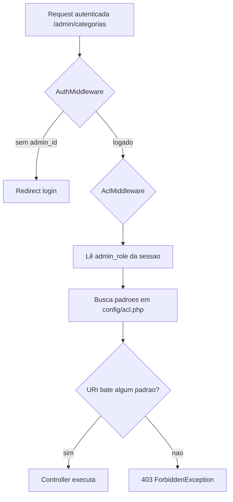

# Módulo — Usuários e ACL (caso do 403)

## O que o usuário vê

- Menu admin com links para Dashboard, Categorias, Produtos, etc.
- Ao clicar em uma área **sem permissão** na sua role → **403** com mensagem "Você não tem permissão para acessar este recurso."
- Caso clássico: rota de **Categorias** existia, menu existia, mas ACL não liberava → 403.

## Lição central

> **Rota registrada ≠ permissão concedida.**

São dois arquivos distintos que você precisa manter sincronizados.

## Fluxo do ACL



## Arquivos na ordem

| # | Arquivo | Papel |
|---|---------|-------|
| 1 | `config/routes/erp.php` | Declara `GET /admin/categorias` → `AdminCategoryController` |
| 2 | `config/middleware.php` | Grupo `admin` = Auth + Acl |
| 3 | `core/Middleware/AuthMiddleware.php` | Garante login |
| 4 | `core/Middleware/AclMiddleware.php` | Compara URI com `config/acl.php` |
| 5 | `config/acl.php` | Lista de paths permitidos por role |
| 6 | `app/Erp/Admin/Views/partials/admin-sidebar.php` | Link no menu (independente do ACL!) |
| 7 | `app/Shared/View/errors/403.php` | Página de erro |

## Como funciona `config/acl.php`

```php
return [
    'admin' => [
        '/admin/dashboard',
        '/admin/produtos*',      // * = prefixo
        '/admin/categorias*',
        // ...
    ],
    'operator' => [
        '/admin/dashboard',
        '/admin/produtos',       // sem * = match exato apenas
        // ...
    ],
];
```

**Padrão com `*`:** `/admin/produtos*` libera `/admin/produtos`, `/admin/produtos/criar`, `/admin/produtos/editar/5`.

**Sem `*`:** só a URL exata.

**Role ausente ou lista vazia:** tudo bloqueado.

## Roles hoje

| Role | Origem | Uso |
|------|--------|-----|
| `admin` | Coluna `usuarios.role` | Acesso amplo ao painel |
| `operator` | Coluna `usuarios.role` | Acesso limitado (sem CRUD completo de usuários, etc.) |

Definida no login: `AuthService` grava `$_SESSION['admin_role']`.

## Gestão de usuários admin

| Peça | Arquivo |
|------|---------|
| CRUD | `AdminUserController` |
| Regras | `UserService` |
| Dados | `UserRepository` → tabela `usuarios` |
| Rotas | `/admin/usuarios*` em `config/routes/erp.php` |
| ACL | `/admin/usuarios*` para role `admin` |

## Diagnóstico passo a passo (403)

1. Você está logado? Se não → redirect login (não é 403).
2. Abra `config/routes/erp.php` — a rota existe?
3. Abra `config/acl.php` — sua role tem padrão que cobre a URI?
4. Confira `$_SESSION['admin_role']` (ou coluna `usuarios.role` no banco).
5. Operador tentando URL só liberada para admin?

## Onde NÃO mexer

- Desabilitar `AclMiddleware` globalmente
- Hardcodar permissões no controller (use `config/acl.php`)
- Assumir que link no sidebar = permissão

## Checklist ao adicionar tela admin

- [ ] Rota em `config/routes/erp.php` com `'middleware' => 'admin'`
- [ ] Padrão em `config/acl.php` para cada role que deve acessar
- [ ] Link no `admin-sidebar.php` (opcional mas UX)
- [ ] Teste com role `operator` se aplicável

## Exercício (caso real)

Você adicionou `/admin/inventario-rapido`. O menu funciona, mas dá 403.

1. Qual arquivo você edita primeiro?
2. Qual linha adicionar para role `admin`?

<details>
<summary>Resposta</summary>

1. `config/acl.php`
2. `'/admin/inventario-rapido*'` no array `'admin'`

</details>

## Teste automatizado de referência

Ver `tests/Unit/MiddlewareTest.php`:

- `testAclBlocksConfiguredRoleWithoutPermission` — URI não listada → exceção
- `testAclAllowsConfiguredAdminRoute` — `/admin/produtos/editar/1` permitido

## Referência oficial

- [ARCHITECTURE.md](../../ARCHITECTURE.md) §4, §11
- [05-receita-nova-feature.md](../05-receita-nova-feature.md)
